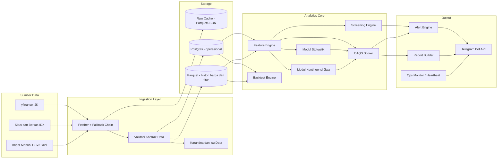
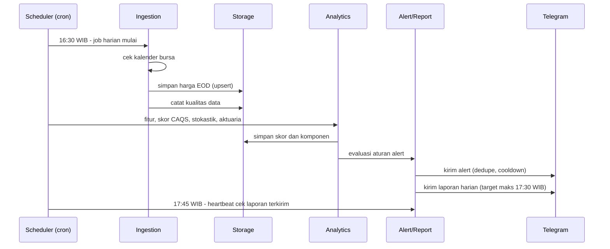

# PRD — Stock Screener Saham BEI (IHSG) dengan Backend Serverless & Integrasi Telegram

| Atribut | Isi |
|---|---|
| **Nama produk** | Stock Screener BEI (kode proyek: `idx-screener`) |
| **Versi dokumen** | 0.2 (Draft untuk review) |
| **Tanggal** | 20 September 2026 |
| **Pemilik produk** | Faiz |
| **Status** | Draft — Q1 (horizon) dan Q5 (universe) sudah terjawab; sisanya menunggu jawaban pada Bagian 19 |
| **Pengguna target** | Personal (single-user), notifikasi via Telegram |
| **Pasar** | Saham Bursa Efek Indonesia (BEI/IDX), acuan IHSG |

> **Disclaimer.** Produk ini adalah alat bantu riset pribadi. Output (skor, sinyal, alert, hasil simulasi) **bukan** rekomendasi investasi. Semua model punya asumsi dan keterbatasan yang dijelaskan di dokumen ini.

---

## Daftar Isi

1. Ringkasan Eksekutif
2. Latar Belakang & Definisi Masalah
3. Tujuan, Non-Tujuan, dan Metrik Keberhasilan
4. Persona & User Stories
5. Ruang Lingkup & Fase Rilis
6. Asumsi, Batasan, dan Dependensi
7. Kebutuhan Fungsional
8. Spesifikasi Model Kuantitatif
9. Spesifikasi Khusus Pasar BEI
10. Arsitektur Sistem
11. Desain Backend & Penjadwalan
12. Model Data
13. Interface: CLI, Konfigurasi, Pesan Telegram
14. Kebutuhan Non-Fungsional
15. Strategi Pengujian & Validasi
16. Risiko & Mitigasi
17. Roadmap & Milestone
18. Estimasi Biaya
19. Pertanyaan Terbuka & Asumsi Default
20. Lampiran

---

## 1. Ringkasan Eksekutif

**Stock Screener BEI** adalah sistem yang setiap hari bursa otomatis mengambil data harga dan fundamental saham BEI, menghitung fitur (rasio fundamental, indikator teknikal, faktor kuantitatif), memberi skor komposit **CAQS**, menjalankan model stokastik (metode numerik) dan model **kontingensi jiwa** (survival/hazard, anuitas kontingen, rantai Markov multi-state), lalu mengirim **laporan harian** dan **alert kondisi** ke Telegram.

Backend berjalan **serverless/cron terjadwal** dengan Python. Sumber data **gratis** (yfinance dan scraping IDX) dengan arsitektur fallback berlapis supaya kegagalan satu sumber tidak menghentikan pipeline.

**Diferensiasi utama:**

1. Skor CAQS yang menggabungkan enam pilar: Fundamental, Kualitas, Teknikal, Faktor (momentum/mean reversion), Risiko Stokastik, dan Kontingensi Aktuaria.
2. Modul kontingensi jiwa yang memperlakukan "umur" sebuah saham sebagai waktu sampai kejadian gagal (drawdown, tembus level stop, distress), sehingga menghasilkan *actuarial fair value* dan peluang bertahan yang dapat dibandingkan dengan harga pasar.
3. Backtesting *point-in-time* yang memperhitungkan biaya transaksi, lot 100 lembar, batas ARA/ARB, dan bias survivorship.
4. Desain yang jujur soal kualitas data: setiap skor membawa **confidence score** berdasarkan kelengkapan dan kesegaran data.

---

## 2. Latar Belakang & Definisi Masalah

### 2.1 Latar belakang
Pasar saham Indonesia memiliki ratusan emiten dengan data yang tersebar (situs IDX, laporan keuangan PDF/Excel/XBRL, agregator harga). Menyaring saham secara manual memakan waktu dan rawan bias. Layanan screener komersial sering berbayar, tidak dapat dikustomisasi pada level model (misalnya memasukkan model stokastik atau kontingensi jiwa), dan tidak terintegrasi dengan alur kerja pribadi seperti Telegram.

### 2.2 Masalah yang diselesaikan

| # | Masalah | Dampak |
|---|---|---|
| P1 | Data fundamental dan harga BEI tersebar dan tidak konsisten | Waktu riset besar, keputusan berbasis data tidak lengkap |
| P2 | Screener publik tidak mendukung model kuantitatif kustom | Tidak bisa menguji hipotesis berbasis matematika aktuaria |
| P3 | Tidak ada pemantauan otomatis terhadap perubahan skor/sinyal | Perubahan penting terlewat |
| P4 | Backtest sederhana sering bias (look-ahead, survivorship, tanpa biaya) | Kepercayaan berlebih pada strategi yang tampak bagus |
| P5 | Risiko sering diabaikan dibanding potensi return | Keputusan tidak disiplin terhadap risiko |

### 2.3 Peluang
Dengan menggabungkan data gratis, komputasi serverless murah, dan kompetensi matematika/aktuaria pemilik produk, dapat dibangun alat riset yang murah, transparan, dan dapat diaudit sampai level rumus.

---

## 3. Tujuan, Non-Tujuan, dan Metrik Keberhasilan

### 3.1 Tujuan produk

| ID | Tujuan |
|---|---|
| G1 | Menyediakan pipeline data BEI harian yang otomatis, tangguh, dan dapat diaudit |
| G2 | Menyediakan screening berbasis aturan (filter) dan peringkat berbasis skor CAQS |
| G3 | Menyediakan analisis risiko forward-looking (simulasi stokastik dan kontingensi jiwa) |
| G4 | Menyediakan backtesting yang jujur secara metodologi |
| G5 | Mengirim laporan harian dan alert relevan ke Telegram tanpa intervensi manual |
| G6 | Biaya operasional mendekati nol pada tahap MVP |

### 3.2 Non-tujuan (di luar cakupan)

- Eksekusi order otomatis atau integrasi ke broker.
- Rekomendasi investasi personal atau layanan penasihat investasi untuk pihak lain.
- Prediksi harga jangka pendek berbasis machine learning kotak-hitam.
- Data real-time tick-by-tick atau order book (butuh data berbayar).
- Multi-pasar (saham US, kripto) pada versi 1.
- Aplikasi web/mobile penuh (dashboard hanya opsional di fase lanjut).

### 3.3 Metrik keberhasilan (KPI)

**A. Keandalan operasional**

| KPI | Target | Pengukuran |
|---|---|---|
| Laporan harian terkirim pada hari bursa sebelum 17:30 WIB | ≥ 95% (rolling 30 hari bursa) | `job_runs` + `notifications_log` |
| Cakupan harga EOD universe aktif | ≥ 98% | `data_quality_issues` |
| Cakupan fundamental untuk 200 saham teratas (likuiditas) | ≥ 85% | Coverage report |
| Durasi pipeline harian (p95) | < 25 menit | `job_runs.duration_s` |
| Kegagalan senyap (job gagal tanpa alert admin) | 0 | Heartbeat monitor |

**B. Kualitas sinyal dan alert**

| KPI | Target | Pengukuran |
|---|---|---|
| Rata-rata alert per hari | ≤ 10 | `alert_events` |
| Alert yang dinilai berguna oleh pemilik (feedback sederhana) | ≥ 60% setelah 4 minggu | Field `useful` pada `alert_events` |
| Duplikasi alert dalam periode cooldown | 0 | Uji otomatis |

**C. Kualitas model (target awal, bukan janji kinerja)**

| KPI | Target | Pengukuran |
|---|---|---|
| Rank IC (Spearman) skor CAQS terhadap return maju 20 hari, out-of-sample | Rata-rata > 0 dengan 95% CI tidak mencakup 0 | Walk-forward backtest |
| Spread kuintil teratas vs terbawah (neto biaya) | Positif pada ≥ 60% fold walk-forward | Backtest |
| Kalibrasi peluang (Brier score) vs baseline frekuensi tak bersyarat | Lebih baik ≥ 5% | Validasi modul stokastik/kontingensi |
| Kupiec test untuk VaR 95% | Tidak menolak H0 pada α = 5% | Uji exceedance |

**D. Biaya**

| KPI | Target |
|---|---|
| Biaya bulanan MVP | Rp0 (free tier) |
| Batas atas biaya bulanan setelah produksi | ≤ Rp100.000 |

---

## 4. Persona & User Stories

### 4.1 Persona tunggal: "Peneliti-Investor Personal"
Mahasiswa Matematika dengan minat AI dan Data Science, nyaman dengan Python dan notasi matematika formal, mengelola portofolio kecil hingga menengah, ingin keputusan berbasis data serta paham keterbatasan model. Menerima informasi utama via Telegram di ponsel, dan melakukan analisis lanjutan di laptop.

### 4.2 User stories

| ID | Sebagai pengguna, saya ingin... | Agar... | Prioritas |
|---|---|---|---|
| US-01 | menerima laporan harian di Telegram setelah bursa tutup | saya tahu kondisi pasar dan kandidat terbaik tanpa membuka laptop | Must |
| US-02 | mendapat alert saat skor/sinyal/harga saham di watchlist memenuhi kondisi tertentu | saya tidak melewatkan perubahan penting | Must |
| US-03 | mendefinisikan filter screening di file konfigurasi | saya dapat menyesuaikan strategi tanpa mengubah kode | Must |
| US-04 | melihat rincian skor CAQS per pilar dan per metrik | saya paham *mengapa* sebuah saham berskor tinggi | Must |
| US-05 | melihat confidence score data pada setiap skor | saya tidak tertipu skor dari data yang bolong | Must |
| US-06 | menjalankan backtest untuk aturan screening/skor saya | saya tahu apakah strategi bertahan uji historis | Should |
| US-07 | melihat distribusi hasil simulasi stokastik (peluang naik, peluang tembus level, VaR/ES) | saya menilai risiko ke depan | Should |
| US-08 | melihat *actuarial fair value* dan peluang bertahan (survival) sebuah saham | saya punya pembanding valuasi berbasis aktuaria | Should |
| US-09 | diberi tahu jika pipeline gagal atau data basi | saya tidak mengambil keputusan dari data usang | Must |
| US-10 | mengekspor hasil screening ke CSV/Excel | saya bisa analisis lanjut di alat lain | Could |
| US-11 | menjalankan perintah on-demand di Telegram (mis. `/skor BBCA`) | saya bisa bertanya cepat saat dibutuhkan | Could (v1.1) |

---

## 5. Ruang Lingkup & Fase Rilis

| Fase | Cakupan | Ringkas |
|---|---|---|
| **MVP (v0.x)** | Pipeline EOD untuk **seluruh saham BEI** (dengan gerbang likuiditas), fitur fundamental dan teknikal, filter screening berbasis YAML, CAQS v1 (pilar F, Q, T), laporan harian Telegram, monitoring dasar | Bernilai sejak minggu awal |
| **v1.0** | Cakupan penuh semua papan dengan gerbang dan tingkat kepercayaan data, pilar Faktor (momentum/mean reversion), alert engine lengkap, backtest engine, modul stokastik, modul kontingensi jiwa, pilar SR dan AC, kalibrasi bobot | Sasaran produk lengkap |
| **v1.1** | Perintah Telegram on-demand (webhook), pembuatan grafik, ekspor laporan | Kenyamanan |
| **v2.0** | Dashboard web, sumber data berbayar opsional, deflated Sharpe/reality check, optimasi portofolio | Perluasan |

---

## 6. Asumsi, Batasan, dan Dependensi

### 6.1 Asumsi

| ID | Asumsi |
|---|---|
| A1 | Pengguna tunggal; tidak ada kebutuhan multi-tenant, login, atau billing |
| A2 | Horizon strategi utama: **menengah** (1–6 bulan). Data Yahoo tertunda beberapa menit sehingga swing/intraday **bukan** target; namun ada skenario sekunder penutupan posisi dalam 2–3 hari bursa, sehingga output risiko juga mencakup horizon 3 dan 5 hari. Data harian (EOD) adalah basis |
| A3 | Sumber data gratis cukup untuk riset EOD; tidak diharapkan setara kualitas vendor berbayar |
| A4 | Zona waktu operasi WIB (UTC+7); penjadwalan cron dikonversi ke UTC |
| A5 | Repositori kode privat di GitHub atau setara |
| A6 | Pengembangan paruh waktu (± 10–15 jam/minggu) |
| A8 | **Universe = seluruh saham BEI** (± 950 emiten), dengan gerbang likuiditas/kualitas data sebelum skoring; saham tidak lolos gerbang tetap tersimpan datanya tetapi tidak diberi label kandidat |
| A7 | Suku bunga bebas risiko menggunakan yield SBN tenor 10 tahun atau BI-Rate, diisi via konfigurasi berversi |

### 6.2 Batasan

- **Kualitas data gratis**: cakupan fundamental yfinance untuk emiten BEI tidak merata, data kuartalan sering bolong, dan emiten yang sudah delisting umumnya hilang (risiko survivorship bias).
- **Scraping**: struktur situs IDX dapat berubah; harus patuh syarat penggunaan, robots, dan rate limit yang wajar.
- **Serverless**: stateless; state harus disimpan di penyimpanan eksternal. Jadwal cron gratis bisa terlambat beberapa menit.
- **Data intraday** gratis biasanya tertunda; alert intraday bersifat *best-effort*.
- **Regulasi**: penggunaan pribadi. Jika kelak dipublikasikan atau dikomersialkan, perlu tinjauan hukum terkait penyebaran data pihak ketiga dan aturan penasihat investasi.

### 6.3 Dependensi eksternal

| Dependensi | Fungsi | Risiko | Mitigasi |
|---|---|---|---|
| yfinance (Yahoo Finance, ticker `.JK`) | Harga, sebagian fundamental | API tidak resmi; bisa berubah/di-rate-limit | Cache, retry, fallback |
| Situs/Berkas IDX | Daftar emiten, laporan keuangan, indeks, kalender | Struktur berubah, anti-bot | Parser modular, versi, fallback manual |
| Impor manual (Excel/CSV) | Cadangan terakhir dan koreksi | Butuh tindakan pengguna | Template dan validator |
| Telegram Bot API | Kanal notifikasi | Batas laju, token bocor | Rate limiter, secret manager |
| Platform cron/serverless | Eksekusi terjadwal | Jitter jadwal, kuota | Retry window, heartbeat |
| Penyimpanan (Postgres/objek) | Persistensi | Batas free tier | Retensi dan arsip Parquet |


---

## 7. Kebutuhan Fungsional

Legenda prioritas: **M** = Must, **S** = Should, **C** = Could. Fase: MVP, 1.0, 1.1, 2.0.

### 7.1 Data Ingestion & Universe (FR-DAT)

| ID | Kebutuhan | Prio | Fase |
|---|---|---|---|
| FR-DAT-01 | Sistem mengambil daftar emiten aktif BEI (kode, nama, sektor IDX-IC, papan pencatatan, tanggal listing, status) dan menyimpannya bersama riwayat perubahan (SCD tipe 2) | M | MVP |
| FR-DAT-02 | Sistem mengambil harga harian OHLCV (termasuk *adjusted close*) untuk seluruh universe aktif via yfinance dengan sufiks `.JK`; indeks IHSG (`^JKSE`) sebagai benchmark | M | MVP |
| FR-DAT-03 | Sistem mengambil data fundamental (laba rugi, neraca, arus kas; kuartalan dan tahunan) dari sumber prioritas: (1) berkas/laporan IDX, (2) yfinance, (3) impor manual | M | MVP |
| FR-DAT-04 | Setiap data fundamental disimpan dengan `period_end`, `publish_date` (tanggal terbit/diketahui publik), `source`, `fetched_at`, dan `version` agar analisis *point-in-time* dimungkinkan | M | MVP |
| FR-DAT-05 | Sistem memiliki **rantai fallback berlapis** per jenis data; jika sumber utama gagal atau data gagal validasi, sistem beralih ke sumber berikutnya dan mencatat sumber yang dipakai | M | MVP |
| FR-DAT-06 | Sistem mengambil aksi korporasi (dividen, stock split, reverse split, right issue, bonus) dan menerapkan penyesuaian harga secara konsisten | M | 1.0 |
| FR-DAT-07 | Sistem menyimpan kalender bursa BEI (hari libur dan cuti bersama) dan melewati pipeline pada hari non-bursa | M | MVP |
| FR-DAT-08 | Sistem mengambil data pendukung makro: BI-Rate, yield SBN 10Y, kurs USD/IDR (untuk konfigurasi risk-free dan konteks) — dapat berupa input manual berversi | S | 1.0 |
| FR-DAT-09 | Sistem mendukung *backfill* historis (default 10 tahun harga, sedalam yang tersedia untuk fundamental) secara bertahap dan idempotent | M | MVP |
| FR-DAT-10 | Sistem menjaga cache respons mentah (raw) agar dapat diulang tanpa mengunduh lagi dan untuk audit | S | MVP |
| FR-DAT-11 | Impor manual: template Excel/CSV baku dan validator skema untuk mengisi data yang gagal diambil otomatis | S | MVP |
| FR-DAT-12 | Universe default = **seluruh emiten aktif**; dapat difilter ke IDX30/LQ45/IDX80/KOMPAS100 (daftar konfigurasi) atau daftar kustom. Pengambilan harga memakai *bulk download* per batch untuk menekan risiko rate limit | M | MVP |

### 7.2 Kualitas & Validasi Data (FR-QC)

| ID | Kebutuhan | Prio | Fase |
|---|---|---|---|
| FR-QC-01 | Validasi skema (tipe, rentang, non-null) untuk setiap dataset masuk memakai kontrak data (mis. pandera) | M | MVP |
| FR-QC-02 | Validasi harga: `low ≤ open, close ≤ high`, harga > 0, volume ≥ 0, lonjakan harian melebihi batas ARA/ARB + toleransi ditandai sebagai anomali | M | MVP |
| FR-QC-03 | Deteksi lubang data (hari bursa tanpa bar), bar duplikat, dan harga basi (nilai sama berulang untuk saham likuid) | M | MVP |
| FR-QC-04 | Validasi fundamental: identitas akuntansi (Aset = Liabilitas + Ekuitas dalam toleransi), tanda dan skala satuan (ribu/juta/miliar), deteksi outlier via z-score robust (MAD) | M | MVP |
| FR-QC-05 | Deteksi diskontinuitas akibat aksi korporasi yang belum dikoreksi (mis. lonjakan harga tepat 2x, 0,5x, 10x) | S | 1.0 |
| FR-QC-06 | Setiap saham memiliki **Data Confidence Score** (0–1) = fungsi dari kelengkapan, kesegaran, dan jumlah anomali; ikut menentukan skor akhir (lihat 8.1) | M | MVP |
| FR-QC-07 | Semua isu dicatat pada `data_quality_issues` dengan severity (info/warn/error) dan status penyelesaian | M | MVP |
| FR-QC-08 | Data dengan severity `error` dikarantina dan tidak masuk perhitungan skor; saham terkait diberi status "data tidak lengkap" | M | MVP |

### 7.3 Feature Engineering (FR-FEA)

**Fundamental** (dihitung *point-in-time* memakai `publish_date`)

| ID | Fitur | Prio | Fase |
|---|---|---|---|
| FR-FEA-01 | Valuasi: PER (TTM), PBV, PSR, EV/EBITDA, Dividend Yield, Earnings Yield, Graham Number dan margin of safety | M | MVP |
| FR-FEA-02 | Profitabilitas: ROE, ROA, ROIC (jika data memadai), Gross/Operating/Net Margin | M | MVP |
| FR-FEA-03 | Leverage & likuiditas: DER, Net Debt/EBITDA, Interest Coverage, Current Ratio, Quick Ratio | M | MVP |
| FR-FEA-04 | Pertumbuhan: YoY dan CAGR (3/5 tahun) untuk pendapatan, laba, EPS, DPS; koefisien variasi laba sebagai ukuran stabilitas | M | MVP |
| FR-FEA-05 | Kualitas laba: rasio OCF/Net Income, akrual (Sloan ratio), FCF margin | S | 1.0 |
| FR-FEA-06 | Kesehatan finansial: Altman Z''-score (varian pasar berkembang/non-manufaktur), Piotroski F-score | S | 1.0 |
| FR-FEA-07 | **Metrik khusus perbankan** (jika tersedia): CAR, NPL, NIM, LDR, BOPO, CASA; DER tidak dipakai untuk sektor keuangan | S | 1.0 |
| FR-FEA-08 | Perbandingan relatif sektor: persentil dan z-score metrik terhadap median sektor IDX-IC | M | 1.0 |

**Teknikal**

| ID | Fitur | Prio | Fase |
|---|---|---|---|
| FR-FEA-10 | Tren: SMA/EMA (5, 10, 20, 50, 100, 200), MACD (12,26,9), ADX | M | MVP |
| FR-FEA-11 | Momentum: RSI(14), ROC (5/20/60/120 hari), Stochastic (14,3,3), momentum 12-1 bulan | M | MVP |
| FR-FEA-12 | Volatilitas: ATR(14), Bollinger Bands (20, 2σ), volatilitas realisasi 20/60 hari, GARCH(1,1) volatilitas terprediksi | M | 1.0 |
| FR-FEA-13 | Volume: rata-rata nilai transaksi harian (ADV, dalam Rp), OBV, rasio volume relatif, skor likuiditas | M | MVP |
| FR-FEA-14 | Pola/sinyal: golden/death cross, breakout 52 minggu, RSI keluar dari zona jenuh, MACD cross, jarak ke 52w high/low | M | MVP |
| FR-FEA-15 | Drawdown berjalan dan drawdown maksimum (60/120/252 hari) | M | 1.0 |
| FR-FEA-16 | Indikator kustom: Composite Momentum Index (CMI), Volatility-Adjusted Price (VAP) | C | 1.0 |

**Faktor kuantitatif**

| ID | Fitur | Prio | Fase |
|---|---|---|---|
| FR-FEA-20 | Faktor momentum lintas-seksi (12-1, 6-1) dan reversal jangka pendek (1 bulan) | S | 1.0 |
| FR-FEA-21 | **Mean reversion**: z-score harga terhadap MA, estimasi parameter Ornstein–Uhlenbeck (κ, θ, σ), half-life, uji ADF/Hurst (lihat 8.4) | S | 1.0 |
| FR-FEA-22 | Faktor low-volatility, kualitas, dan nilai sebagai fitur pembanding | C | 1.0 |
| FR-FEA-23 | Beta terhadap IHSG (regresi rolling 252 hari), korelasi antar-saham (matriks kovarians terestimasi dengan shrinkage Ledoit–Wolf) | S | 1.0 |

### 7.4 Screening Engine (FR-SCR)

| ID | Kebutuhan | Prio | Fase |
|---|---|---|---|
| FR-SCR-01 | Screen didefinisikan dalam YAML/JSON: universe, filter (metric, operator, nilai), pengurutan, top-N (lihat 13.2) | M | MVP |
| FR-SCR-02 | Operator: `<, <=, >, >=, ==, !=, between, in, crosses_above, crosses_below, top_pct, bottom_pct` | M | MVP |
| FR-SCR-03 | Filter gerbang wajib (*hard gates*) sebelum skoring: likuiditas minimum (ADV), umur listing minimum, bukan suspensi, bukan papan pemantauan khusus (opsional), kapitalisasi minimum | M | MVP |
| FR-SCR-04 | Preset screen bawaan: *Quality-Value*, *Momentum Breakout*, *Mean-Reversion Oversold*, *Dividend Sustainable*, *Low-Risk Compounder* | S | MVP |
| FR-SCR-05 | Hasil screen disimpan per tanggal (`screen_results`) sehingga dapat dibandingkan hari ke hari (masuk/keluar daftar) | M | MVP |
| FR-SCR-06 | Penjelasan hasil: untuk setiap saham lolos, tampilkan metrik yang memenuhi dan yang hampir gagal | S | 1.0 |
| FR-SCR-07 | Screen dapat dijalankan sebagai bagian pipeline harian maupun manual via CLI | M | MVP |

### 7.5 Skor CAQS (FR-CAQS)

| ID | Kebutuhan | Prio | Fase |
|---|---|---|---|
| FR-CAQS-01 | Menghasilkan skor 0–100 per saham per hari dari agregasi pilar berbobot (rumus di 8.1) | M | MVP |
| FR-CAQS-02 | Pilar MVP: Fundamental (F), Kualitas (Q), Teknikal (T). Pilar 1.0: Faktor (FM), Risiko Stokastik (SR), Kontingensi Aktuaria (AC) | M | MVP/1.0 |
| FR-CAQS-03 | Normalisasi lintas-seksi: winsorize, transformasi persentil atau z-score, opsi netral-sektor | M | MVP |
| FR-CAQS-04 | Penanganan data hilang: penyusutan (shrinkage) ke median dan penalti kepercayaan | M | MVP |
| FR-CAQS-05 | Dekomposisi skor: simpan kontribusi tiap pilar dan tiap metrik (`score_components`) untuk transparansi | M | MVP |
| FR-CAQS-06 | Bobot dan parameter tersimpan sebagai konfigurasi berversi; setiap skor mencatat `model_version` | M | MVP |
| FR-CAQS-07 | Kalibrasi bobot via walk-forward dengan regularisasi ke prior (8.1.6); bobot dibekukan per kuartal | S | 1.0 |
| FR-CAQS-08 | Label hasil (Kandidat Kuat / Kandidat / Netral / Waspada) berdasarkan skor dan gerbang, disertai catatan bahwa label bukan rekomendasi | M | MVP |

### 7.6 Modul Stokastik & Metode Numerik (FR-STO)

| ID | Kebutuhan | Prio | Fase |
|---|---|---|---|
| FR-STO-01 | Estimasi parameter GBM (μ, σ) dari log-return dengan penyusutan dan estimasi σ berbasis EWMA/GARCH | M | 1.0 |
| FR-STO-02 | Estimasi model **Ornstein–Uhlenbeck** untuk sinyal mean reversion (κ, θ, σ, half-life) dengan uji signifikansi | S | 1.0 |
| FR-STO-03 | Simulasi **Monte Carlo** jalur harga (GBM eksak, Euler–Maruyama/Milstein untuk SDE umum, opsi lompatan Merton) dengan variasi antitetik dan seed reprodusibel | M | 1.0 |
| FR-STO-04 | Output per saham untuk horizon H ∈ {3, 5, 20, 60} hari bursa: peluang return > 0, peluang tembus level (barrier) tertentu, kuantil return, VaR dan Expected Shortfall 95/99% | M | 1.0 |
| FR-STO-05 | Penyelesaian PDE peluang first-passage/barrier dengan **finite difference (Crank–Nicolson)** sebagai pembanding silang terhadap Monte Carlo dan solusi tertutup GBM | S | 1.0 |
| FR-STO-06 | Kendala pasar BEI dalam simulasi: pemotongan return harian pada batas ARA/ARB, pembulatan ke fraksi harga (tick), dan penalti likuiditas | S | 1.0 |
| FR-STO-07 | Kontrol galat numerik: laporan standard error Monte Carlo, uji konvergensi (orde kekuatan/lemah), N adaptif hingga SE < toleransi | M | 1.0 |
| FR-STO-08 | Semua hasil diringkas menjadi **Skor Risiko Stokastik (SR)** yang masuk ke CAQS | M | 1.0 |
| FR-STO-09 | Simulasi portofolio (opsional): jalur berkorelasi memakai dekomposisi Cholesky matriks kovarians | C | 2.0 |

### 7.7 Modul Kontingensi Jiwa / Aktuaria (FR-ACT)

| ID | Kebutuhan | Prio | Fase |
|---|---|---|---|
| FR-ACT-01 | Definisi konfigurasi **"kejadian gagal"** (mis. drawdown ≥ d% dari puncak, harga tembus barrier bawah entry, suspensi ≥ n hari, pemotongan dividen, skor distress melewati ambang) | M | 1.0 |
| FR-ACT-02 | Konstruksi *life table* saham: pengamatan berkala (bulanan) dengan sensor kanan; estimasi **Kaplan–Meier** (nonparametrik) | M | 1.0 |
| FR-ACT-03 | Estimasi hazard parametrik (Weibull, Gompertz) dan **Cox Proportional Hazards** dengan kovariat (leverage, volatilitas, likuiditas, profitabilitas, ukuran) | S | 1.0 |
| FR-ACT-04 | Perhitungan fungsi aktuaria: S(t), tpx, qx, μx, harapan sisa umur | M | 1.0 |
| FR-ACT-05 | **Anuitas kontingen dividen**: nilai sekarang aktuaria arus dividen bersyarat bertahan (`ä`) | M | 1.0 |
| FR-ACT-06 | **Actuarial Fair Value**: nilai sekarang aktuaria dari dividen, nilai terminal bersyarat bertahan, dan nilai pemulihan saat gagal; hitung margin of safety terhadap harga pasar | M | 1.0 |
| FR-ACT-07 | **Rantai Markov multi-state** (Sehat, Waspada, Distress, Terminasi): estimasi matriks intensitas Q dan transisi P(t) = exp(Qt) via persamaan Kolmogorov (numerik) | S | 1.0 |
| FR-ACT-08 | Premi risiko aktuaria (expected loss rate) per saham dan per horizon | S | 1.0 |
| FR-ACT-09 | Hasil diringkas menjadi **Skor Kontingensi Aktuaria (AC)** yang masuk ke CAQS | M | 1.0 |
| FR-ACT-10 | Diagnostik: kurva survival per kuintil skor, uji log-rank antar kelompok, uji proporsionalitas hazard (Schoenfeld) | S | 1.0 |

### 7.8 Backtesting (FR-BT)

| ID | Kebutuhan | Prio | Fase |
|---|---|---|---|
| FR-BT-01 | Backtest berbasis aturan (screen) atau skor (top-N/kuintil) dengan frekuensi rebalancing terkonfigurasi (mingguan, bulanan, kuartalan) | M | 1.0 |
| FR-BT-02 | Data *point-in-time*: fundamental hanya digunakan setelah `publish_date` (+ lag konservatif bila tanggal tidak diketahui) | M | 1.0 |
| FR-BT-03 | Model biaya: fee beli/jual (termasuk pajak final), slippage berbasis spread/ADV, pembulatan lot 100 lembar, batas partisipasi volume | M | 1.0 |
| FR-BT-04 | Model eksekusi realistis: eksekusi di harga pembukaan hari berikutnya atau VWAP proksi; larangan beli/jual pada saham suspensi dan yang menyentuh ARA/ARB tanpa likuiditas | M | 1.0 |
| FR-BT-05 | Metrik: CAGR, volatilitas, Sharpe, Sortino, Calmar, Max Drawdown, durasi drawdown, win rate, profit factor, turnover, exposure, tracking error dan alpha/beta terhadap IHSG | M | 1.0 |
| FR-BT-06 | Metrik sinyal: Rank IC per periode, IC-IR, laba kuintil, spread Q5–Q1, decay IC per horizon | M | 1.0 |
| FR-BT-07 | Validasi: walk-forward (expanding/rolling), *purged & embargoed* cross-validation, bootstrap blok untuk interval kepercayaan | M | 1.0 |
| FR-BT-08 | Analisis sensitivitas: grid parameter (bobot, ambang, biaya) dengan peta panas kestabilan | S | 1.0 |
| FR-BT-09 | Simulasi Monte Carlo atas urutan return strategi untuk distribusi drawdown | S | 1.0 |
| FR-BT-10 | Penanganan bias: peringatan eksplisit survivorship bias pada laporan; koreksi jika daftar delisting tersedia | M | 1.0 |
| FR-BT-11 | Laporan backtest reprodusibel (config hash, versi data, seed) dan disimpan (`backtest_runs`) | M | 1.0 |
| FR-BT-12 | Koreksi multiple testing: Deflated Sharpe Ratio / White's Reality Check | C | 2.0 |

### 7.9 Telegram: Laporan Harian & Alert (FR-TG)

| ID | Kebutuhan | Prio | Fase |
|---|---|---|---|
| FR-TG-01 | Bot Telegram mengirim pesan hanya ke `chat_id` yang diizinkan (allowlist); token disimpan sebagai secret | M | MVP |
| FR-TG-02 | **Laporan harian otomatis** pada hari bursa setelah pipeline selesai (target ≤ 17:30 WIB): ringkasan pasar, top-N CAQS, pergerakan skor terbesar, ringkasan alert, status watchlist, ringkasan risiko, status kesehatan data (template di 13.3) | M | MVP |
| FR-TG-03 | **Alert kondisi** dengan kategori: (a) sinyal teknikal, (b) harga, (c) perubahan skor/peringkat, (d) risiko (hazard/peluang tembus barrier naik), (e) kesehatan data/pipeline (admin) | M | 1.0 (MVP: a–c dasar) |
| FR-TG-04 | Aturan alert didefinisikan dalam konfigurasi (`alerts.yaml`), dengan parameter cooldown, histeresis, dan tingkat keparahan | M | 1.0 |
| FR-TG-05 | Deduplikasi dan cooldown: alert yang sama tidak dikirim ulang selama periode cooldown kecuali tingkat keparahan naik | M | 1.0 |
| FR-TG-06 | Batas laju pengiriman dan pemecahan pesan panjang (batas 4096 karakter/pesan); penanganan error 429 dengan backoff; escaping MarkdownV2 atau HTML aman | M | MVP |
| FR-TG-07 | Ringkasan mingguan (opsional) berisi kinerja screen, perubahan peringkat, dan metrik kesehatan data | C | 1.0 |
| FR-TG-08 | Kanal admin terpisah (atau prefix tertentu) untuk kegagalan job, data basi, dan heartbeat harian | M | MVP |
| FR-TG-09 | Setiap notifikasi dicatat (`notifications_log`): isi, waktu, status kirim, id pesan | M | MVP |
| FR-TG-10 | Umpan balik ringan pada alert (tombol inline "berguna/tidak") — memerlukan webhook | C | 1.1 |
| FR-TG-12 | Ringkasan risiko posisi pendek: untuk saham watchlist yang ditandai sebagai posisi terbuka (harga beli, tanggal), sertakan pada laporan harian peluang tembus stop, VaR/ES horizon 3–5 hari, dan status sinyal | C | 1.0 |
| FR-TG-11 | Perintah on-demand (`/skor`, `/screen`, `/watch`, `/risiko`) melalui webhook | C | 1.1 |

### 7.10 Konfigurasi & Operasional (FR-CFG / FR-OPS)

| ID | Kebutuhan | Prio | Fase |
|---|---|---|---|
| FR-CFG-01 | Semua parameter (bobot, ambang, universe, watchlist, jadwal, biaya) di file konfigurasi berversi di repositori (*config-as-code*) | M | MVP |
| FR-CFG-02 | Skema konfigurasi divalidasi (pydantic) saat start; konfigurasi salah membuat job gagal cepat dengan pesan jelas | M | MVP |
| FR-CFG-03 | Parameter pasar BEI (ARA/ARB, fraksi harga, ukuran lot, fee, jam bursa) disimpan sebagai tabel parameter berversi berdasarkan tanggal efektif | M | MVP |
| FR-OPS-01 | Setiap job menulis `job_runs` (status, durasi, jumlah baris, sumber data) | M | MVP |
| FR-OPS-02 | Job bersifat **idempotent**: dijalankan ulang untuk tanggal yang sama menghasilkan hasil yang sama tanpa duplikasi | M | MVP |
| FR-OPS-03 | Retry dengan backoff eksponensial dan *retry window* terjadwal (percobaan ulang pada jam berikutnya) | M | MVP |
| FR-OPS-04 | Heartbeat (dead man's switch): jika laporan harian tidak terkirim pada batas waktu, admin diberi tahu | M | MVP |
| FR-OPS-05 | Pemantauan kesegaran data (freshness) dan cakupan; alert admin bila di bawah ambang | M | MVP |
| FR-OPS-06 | Logging terstruktur (JSON) dengan `run_id` dan `correlation_id` | M | MVP |
| FR-OPS-07 | Retensi dan arsip data (kompresi Parquet untuk data lama) | S | 1.0 |
| FR-OPS-08 | CLI untuk backfill, rerun, dry-run, uji alert, dan ekspor | M | MVP |

---

## 8. Spesifikasi Model Kuantitatif

Bagian ini menetapkan **kontrak matematis** tiap modul. Nilai bobot dan ambang adalah *prior awal* yang harus dikalibrasi dan divalidasi (Bagian 15), bukan kebenaran final.

### 8.1 Skor CAQS

#### 8.1.1 Struktur
Untuk saham *i* pada tanggal *t*:

```
CAQS_i,t = 100 × Σ_p  w_p × S_p,i,t          p ∈ {F, Q, T, FM, SR, AC}
Σ_p w_p = 1,   w_p ≥ w_min (mis. 0,05),   S_p,i,t ∈ [0, 1]
```

| Pilar | Isi | Bobot prior (v1.0) | Tersedia di |
|---|---|---|---|
| **F** Fundamental / valuasi | PBV, PER, EV/EBITDA, Dividend Yield, Earnings Yield, pertumbuhan laba/pendapatan, margin of safety Graham | 0,20 | MVP |
| **Q** Kualitas | ROE, stabilitas laba (CV), DER/Interest Coverage, margin konsisten, OCF/NI, Piotroski | 0,15 | MVP |
| **T** Teknikal | Posisi terhadap MA, MACD, RSI, ROC, konfirmasi volume, jarak ke 52w-high | 0,15 | MVP |
| **FM** Faktor | Momentum 12-1, reversal 1 bulan, mean reversion (z-score OU, half-life) | 0,20 | 1.0 |
| **SR** Risiko stokastik | Peluang return positif, VaR/ES, peluang tembus barrier, volatilitas terprediksi | 0,15 | 1.0 |
| **AC** Kontingensi aktuaria | Survival probability, margin of safety aktuaria, premi risiko aktuaria | 0,15 | 1.0 |

Pada **MVP**, hanya F, Q, T yang aktif; bobot dinormalkan ulang (mis. F 0,40 · Q 0,30 · T 0,30).

> Catatan: rincian metrik dan bobot CAQS versi Anda sebelumnya dapat dimasukkan langsung ke tabel di atas; PRD ini menetapkan *kerangka* dan titik integrasi, bukan menimpa desain Anda.

#### 8.1.2 Skor metrik individual
Untuk metrik *m* pada pilar *p*:

1. **Winsorize** pada persentil 1 dan 99 (per hari, lintas-seksi).
2. **Arah**: metrik "makin kecil makin baik" (PER, PBV, DER) dibalik.
3. **Transformasi**: persentil rank `r ∈ [0,1]` (default) atau z-score yang dipetakan dengan CDF normal.
4. **Netral-sektor (opsional)**: hitung persentil di dalam sektor IDX-IC (minimal 5 emiten; jika kurang, gunakan seluruh universe).
5. **Skor pilar**: rata-rata berbobot metrik, `S_p = Σ_m a_m × s_m`, dengan `Σ a_m = 1`.

#### 8.1.3 Kasus khusus
- **Sektor keuangan**: DER, Current Ratio, EV/EBITDA tidak dipakai; gunakan CAR, NPL, NIM, BOPO, LDR (bila tersedia) atau ROE dan PBV saja.
- **PER negatif atau laba negatif**: PER dianggap tidak bermakna; gunakan skor 0 pada komponen PER dan tandai `negative_earnings = true`.
- **Ekuitas negatif**: PBV dan ROE tidak bermakna; tandai dan penalti kualitas.

#### 8.1.4 Data hilang dan confidence
Misal `c_p ∈ [0,1]` adalah fraksi bobot metrik yang tersedia pada pilar *p*.

```
S_p (terkoreksi) = c_p × S_p (observasi) + (1 − c_p) × 0,5      (shrinkage ke median)
DataConfidence   = (Σ_p w_p × c_p) × freshness_factor × (1 − anomaly_penalty)
```

`freshness_factor` turun jika harga terakhir lebih tua dari 1 hari bursa atau fundamental lebih tua dari 2 kuartal.

#### 8.1.5 Gerbang (hard gates) — dievaluasi sebelum skoring

| Gerbang | Default | Keterangan |
|---|---|---|
| ADV 20 hari | ≥ Rp1 miliar | Hindari saham tidak likuid |
| Umur listing | ≥ 250 hari bursa | Data histori memadai |
| Status | Bukan suspensi; opsi mengecualikan papan pemantauan khusus | Risiko eksekusi |
| Kapitalisasi pasar | ≥ Rp500 miliar | Bisa disesuaikan |
| Data confidence | ≥ 0,6 | Di bawah itu, skor tampil tetapi diberi label "data terbatas" |

#### 8.1.6 Kalibrasi bobot (walk-forward, teregularisasi)
```
maximize_w   mean_OOS( RankIC_h(w) ) − λ × ||w − w_prior||²
subject to   Σ w = 1,  w ≥ w_min
```
- Latih pada jendela ekspansif, uji pada blok berikutnya (mis. latih 5 tahun, uji 6 bulan, geser 6 bulan).
- Laporkan kestabilan bobot antar-fold; bobot dibekukan per kuartal.
- Tidak boleh memilih bobot dari hasil in-sample terbaik. Sertakan jumlah konfigurasi yang dicoba pada laporan (untuk koreksi multiple testing di 2.0).

#### 8.1.7 Label hasil

| Rentang CAQS | Label | Syarat tambahan |
|---|---|---|
| ≥ 80 | Kandidat Kuat | Lolos gerbang, confidence ≥ 0,7 |
| 65 – < 80 | Kandidat | Lolos gerbang |
| 50 – < 65 | Netral | — |
| < 50 | Waspada | — |

Label adalah ringkasan statistik, **bukan** anjuran beli/jual.

### 8.2 Indikator & Rasio (definisi baku)

```
PER            = Harga / EPS(TTM)
PBV            = Harga / BVPS
ROE            = Laba bersih (TTM) / Rata-rata ekuitas
DER            = Total utang berbunga / Total ekuitas
Div. Yield     = DPS (12 bulan) / Harga
CAGR           = (Nilai_akhir / Nilai_awal)^(1/n) − 1
CV laba        = σ(pertumbuhan laba) / |μ(pertumbuhan laba)|
Graham Number  = √(22,5 × EPS × BVPS);  target konservatif = 0,7 × Graham Number
SMA_n          = rata-rata harga n periode
RSI            = 100 − 100/(1+RS),  RS = rata-rata kenaikan / rata-rata penurunan (smoothing Wilder)
MACD           = EMA12 − EMA26;  signal = EMA9(MACD)
Bollinger      = SMA20 ± 2σ20
ATR            = EMA-Wilder dari True Range
Drawdown_t     = P_t / max_{s≤t} P_s − 1
ADV (Rp)       = rata-rata(harga_penutupan × volume) 20 hari
```

Seluruh implementasi diverifikasi terhadap pustaka referensi (TA-Lib/pandas-ta) pada uji unit (Bagian 15).

### 8.3 Model Stokastik & Metode Numerik

#### 8.3.1 Geometric Brownian Motion (baseline)
```
dS_t = μ S_t dt + σ S_t dW_t
Diskretisasi eksak:  S_{t+Δ} = S_t · exp( (μ − σ²/2)Δ + σ√Δ · Z ),   Z ~ N(0,1)
```
- Estimasi σ: EWMA (λ = 0,94) atau prediksi GARCH(1,1); μ disusutkan kuat ke nol/risk-free karena estimasi drift sangat berisik.
- Horizon default H ∈ {3, 5, 20, 60} hari bursa (3–5 hari untuk skenario penutupan posisi pendek; 20–60 untuk horizon menengah); Δ = 1 hari bursa (1/252 tahun).

#### 8.3.2 Mean reversion — Ornstein–Uhlenbeck
Pada `X_t = ln(P_t) − ln(MA_L(t))` atau spread tertentu:
```
dX_t = κ (θ − X_t) dt + σ dW_t
Diskretisasi eksak:  X_{t+Δ} = θ + (X_t − θ) e^{−κΔ} + σ √[(1 − e^{−2κΔ}) / (2κ)] · Z
Estimasi (AR(1)):    X_{t+1} = a + b X_t + ε,   κ = −ln(b)/Δ,  θ = a/(1−b),  half-life = ln2/κ
Uji kelayakan:       ADF (H0: unit root), batas κ > 0, half-life ∈ [3, 120] hari
```
Skor mean reversion tinggi hanya jika uji signifikan **dan** harga jauh di bawah θ (peluang rebound), dengan filter kualitas (agar tidak menangkap "pisau jatuh").

#### 8.3.3 Model lompatan (Merton) — opsional
```
dS_t / S_{t−} = (μ − λ k) dt + σ dW_t + (J − 1) dN_t,   N ~ Poisson(λ),   ln J ~ N(m, δ²)
```
Digunakan untuk menangkap *gap* dan ekor tebal (relevan bagi saham dengan ARA/ARB).

#### 8.3.4 Skema numerik SDE
| Skema | Persamaan | Orde kekuatan | Penggunaan |
|---|---|---|---|
| Euler–Maruyama | `X_{n+1} = X_n + a Δ + b √Δ Z` | 0,5 | Baseline SDE umum |
| Milstein | tambah `½ b b' (Z²−1)Δ` | 1,0 | Akurasi lebih baik bila `b` bergantung state |
| Eksak (GBM, OU) | solusi tertutup | ∞ | Dipakai bila tersedia |

**Uji konvergensi**: bandingkan error terhadap solusi eksak untuk Δ ∈ {1, 1/2, 1/4, ...}; slope log–log harus mendekati orde teoretis.

#### 8.3.5 Monte Carlo
- Jumlah jalur default `N = 10.000` (adaptif hingga standard error < toleransi, maks 100.000).
- **Variasi antitetik** (Z dan −Z); *control variate* opsional memakai ekspektasi eksak `E[S_T]`.
- Seed deterministik: `seed = hash(ticker, tanggal, model_version)` agar hasil dapat direproduksi.
- Estimator dan galat: `p̂ = (1/N) Σ 1{kejadian}`, `SE = √(p̂(1−p̂)/N)`.
- Pemotongan: return harian dibatasi ke rentang `[ARB, ARA]` sesuai parameter tanggal efektif.

#### 8.3.6 PDE barrier / first-passage (pembanding silang)
Peluang `u(t, x)` bahwa `ln S` menyentuh barrier bawah `b` sebelum `T`, dengan `x = ln s`:
```
∂u/∂t + (μ − σ²/2) ∂u/∂x + ½ σ² ∂²u/∂x² = 0,    u(t, b) = 1,    u(T, x) = 0  untuk x > b
```
Diselesaikan dengan **Crank–Nicolson** pada grid seragam di ruang log. Untuk GBM dengan drift konstan tersedia solusi tertutup (refleksi):
```
P(min_{0≤t≤T} S_t ≤ B) = N( (b − x0 − νT)/(σ√T) ) + e^{2ν(b − x0)/σ²} · N( (b − x0 + νT)/(σ√T) ),   ν = μ − σ²/2, b = ln B, x0 = ln S₀
```
Solusi ini menjadi **uji verifikasi** untuk Monte Carlo dan PDE (ketiganya harus konsisten dalam toleransi).

#### 8.3.7 Output stokastik per saham
`P(R_H > 0)`, `E[R_H]`, kuantil 5/25/50/75/95, `VaR_α`, `ES_α` untuk α ∈ {95%, 99%}, `P(touch B)` untuk B = harga − 8/12/15%, waktu ekspektasi kembali ke θ (OU).

#### 8.3.8 Skor SR (Risiko Stokastik)
```
S_SR = ½ · pct( P(R_20 > 0) )  +  ¼ · pct_inv( ES_95,20 )  +  ¼ · pct_inv( P(touch B) )
```
`pct` = persentil naik, `pct_inv` = persentil terbalik (risiko lebih kecil → skor lebih tinggi). Bobot internal tunduk pada kalibrasi.

#### 8.3.9 Validasi model stokastik
- **Kalibrasi peluang**: Brier score, diagram reliabilitas, PIT histogram untuk kuantil prediksi.
- **VaR backtest**: Kupiec (proporsi exceedance) dan Christoffersen (independensi).
- **Baseline pembanding**: frekuensi historis tak bersyarat dan model naif σ konstan.
- **Stress**: asumsi ekor tebal (Student-t / lompatan) dibandingkan asumsi normal.

### 8.4 Modul Kontingensi Jiwa (Life Contingencies)

Prinsip: sebuah saham diperlakukan seperti "kehidupan" yang dapat "gugur" oleh kejadian gagal. Analogi aktuaria dipakai secara sadar sebagai *kerangka pemodelan*, bukan klaim bahwa saham berperilaku seperti mortalitas manusia.

#### 8.4.1 Definisi kejadian dan umur
- **Kejadian gagal** (dapat dikonfigurasi, dapat lebih dari satu definisi):
  - K1: drawdown dari puncak lokal ≥ d (default 25%).
  - K2: harga menutup di bawah barrier `B = (1 − b) × harga_masuk` (default b = 15%).
  - K3: suspensi ≥ n hari bursa atau masuk papan pemantauan khusus.
  - K4: pemotongan/penghapusan dividen (untuk saham dividen).
  - K5: skor distress (Altman Z'') memasuki zona distress.
- **Umur** `T`: waktu (hari bursa/tahun) dari titik pengamatan sampai kejadian; observasi yang belum gagal pada akhir jendela adalah **tersensor kanan**.
- **Dataset**: panel "banyak kehidupan" dari titik asal bergulir (mis. akhir tiap bulan) per saham; gunakan galat standar klaster per emiten karena jendela tumpang tindih.

#### 8.4.2 Fungsi survival & hazard
```
S(t)   = P(T > t) = exp( − ∫₀ᵗ μ(s) ds )                 (μ = force of failure)
tp_x   = S(x+t) / S(x)                                     (peluang bertahan t periode dari usia x)
q_x    = 1 − p_x = 1 − exp( − ∫_x^{x+1} μ(s) ds )         (peluang gagal dalam 1 periode)
e_x    = ∫₀^∞ tp_x dt                                      (harapan sisa umur; dipotong pada horizon)
```
**Estimasi:**
- *Nonparametrik*: Kaplan–Meier `Ŝ(t) = Π_{t_i ≤ t} (1 − d_i/n_i)` dengan interval kepercayaan Greenwood.
- *Parametrik*: Weibull `μ(t) = (k/λ)(t/λ)^{k−1}`; Gompertz `μ(x) = B c^x`.
- *Semi-parametrik*: **Cox PH** `μ(t | z) = μ₀(t) · exp(β′z)`; kovariat `z` = {DER, Interest Coverage, volatilitas 60 hari, ADV/kapitalisasi, ROE, dummy laba negatif, desil kapitalisasi, drawdown berjalan, sektor}.
- Pilih model berdasarkan AIC/BIC dan konkordansi (C-index) out-of-sample.

#### 8.4.3 Anuitas kontingen dan nilai aktuaria
Misal `v = 1/(1+i)` dengan `i` = risk-free + premi ekuitas (parameter), `D_k` = ekspektasi dividen tahun ke-k (dari kebijakan payout dan proyeksi laba), `TV_n` = nilai terminal kondisional bertahan, `R_k` = nilai pemulihan jika gagal pada tahun k.

```
Anuitas dividen kontingen:      ä_div = Σ_{k=1..n} v^k · kp₀ · E[D_k]
Nilai terminal bersyarat:       A_term = v^n · np₀ · TV_n
Nilai pemulihan (mirip asuransi): A_rec = Σ_{k=0..n−1} v^{k+1} · kp₀ · q_k · R_k

Actuarial Fair Value:           V_act = ä_div + A_term + A_rec
Margin of Safety aktuaria:      MoS_act = V_act / P₀ − 1
Premi risiko aktuaria (per th): π = Σ v^{k+1} kp₀ q_k · L_k  /  ä_div      (L_k = 1 − R_k/P_k, severitas)
```
`TV_n` dapat memakai pertumbuhan Gordon konservatif `TV_n = D_{n+1}/(i − g)` dengan `g` dibatasi (mis. ≤ 3%) atau kelipatan EBITDA/PBV historis sektor. **Analisis sensitivitas** wajib atas `i`, `g`, dan definisi kejadian.

#### 8.4.4 Model multi-state (Markov waktu kontinu)
Keadaan: **1 Sehat**, **2 Waspada**, **3 Distress**, **4 Terminasi** (absorbing).
```
Generator Q (intensitas transisi; tiap baris berjumlah 0), contoh struktur:
      ⎡ −(q12+q13)   q12        q13       0    ⎤
  Q = ⎢  q21      −(q21+q23+q24) q23      q24  ⎥
      ⎢  q31         q32     −(q31+q32+q34) q34 ⎥
      ⎣   0           0         0         0    ⎦

Peluang transisi:  P(t) = exp(Q t)
Persamaan maju Kolmogorov:  dP/dt = P · Q ,  P(0) = I
```
- Definisi keadaan dari aturan objektif (mis. Waspada = drawdown 15–25% atau Z'' zona abu-abu; Distress = drawdown > 25% dan Interest Coverage < 1,5).
- Estimasi MLE intensitas: `q̂_ij = N_ij / T_i` (jumlah transisi i→j dibagi total waktu di keadaan i).
- Hitung `P(t)` dengan `scipy.linalg.expm` (Padé) dan verifikasi silang dengan RK4 pada persamaan Kolmogorov.
- Output: peluang berada di keadaan *s* pada horizon H, peluang absorbsi, waktu ekspektasi ke Distress.

#### 8.4.5 Skor AC (Kontingensi Aktuaria)
```
S_AC = 0,40 · pct( MoS_act )  +  0,35 · pct( 20-hari/60-hari survival tpx )  +  0,25 · pct_inv( π )
```
Dengan `pct` dan `pct_inv` seperti di 8.3.8; bobot internal dikalibrasi.

#### 8.4.6 Diagnostik & validasi
- Kurva KM per kuintil CAQS (pemisahan seharusnya monoton), uji log-rank, uji asumsi proporsionalitas (Schoenfeld).
- Kalibrasi peluang bertahan vs frekuensi realisasi (Brier, reliabilitas).
- Uji stabilitas: estimasi ulang pada sub-periode (pra/pasca-2020, rezim volatilitas).
- Sensitivitas terhadap definisi kejadian (d, b, n).

#### 8.4.7 Batasan model yang harus disampaikan pada output
1. Drawdown dan harga bukan mortalitas: proses harga tidak stasioner dan terpengaruh rezim pasar.
2. Sampel kejadian gagal terbatas pada emiten yang masih tercatat (survivorship bias) sehingga hazard cenderung **terlalu rendah**.
3. Proyeksi dividen dan `TV_n` sangat sensitif; `V_act` adalah *estimasi bersyarat asumsi*, bukan harga wajar pasti.
4. Korelasi antar-saham (risiko sistemik) tidak tercermin pada hazard tunggal; gunakan penanda rezim pasar sebagai kovariat.

### 8.5 Pemrosesan Data Kuantitatif: aturan baku

| Aturan | Spesifikasi |
|---|---|
| Return | Log-return dari *adjusted close* |
| Kalender | Hari bursa BEI; libur/cuti bersama dikecualikan |
| Outlier | Winsorize 1%/99% lintas-seksi; MAD-z > 5 ditandai |
| Data hilang harga | Forward-fill maksimal 3 hari bursa; lebih dari itu ditandai hilang |
| Data hilang fundamental | Tidak diisi maju melewati 2 kuartal tanpa penanda kesegaran |
| Reproduksibilitas | Semua acak memakai seed deterministik; versi data dan model dicatat |

---

## 9. Spesifikasi Khusus Pasar BEI

> Seluruh parameter di bawah **wajib disimpan sebagai tabel parameter berversi (tanggal efektif)**, bukan konstanta di kode, karena regulasi BEI dapat berubah. Nilai contoh perlu diverifikasi ke pengumuman BEI terbaru sebelum implementasi.

| Aspek | Ketentuan / perilaku | Implikasi desain |
|---|---|---|
| **Kode & sufiks** | Kode 4 huruf; di yfinance memakai sufiks `.JK` (mis. `BBCA.JK`); IHSG = `^JKSE` | Pemetaan ticker BEI ↔ yfinance di tabel `instruments` |
| **Satuan lot** | 1 lot = 100 lembar | Backtest dan ukuran posisi dibulatkan ke lot |
| **Fraksi harga (tick size)** | Bergantung rentang harga (mis. Rp1 untuk < 200, Rp2 untuk 200–< 500, Rp5 untuk 500–< 2.000, Rp10 untuk 2.000–< 5.000, Rp25 untuk ≥ 5.000) | Pembulatan harga pada simulasi dan slippage; parameter berversi |
| **ARA/ARB** | Batas kenaikan/penurunan harian bergantung rentang harga dan kebijakan BEI yang dapat berubah (termasuk penyesuaian sementara) | Pemotongan return simulasi, filter anomali, larangan eksekusi saat terkunci |
| **Jam perdagangan** | Kira-kira 09:00–16:00 WIB dengan jeda siang dan sesi pra-penutupan; berbeda Jumat | Jadwal alert intraday dan pemicu laporan; verifikasi jadwal terbaru |
| **Kalender** | Libur nasional dan cuti bersama BEI | Tabel `trading_calendar` dan pengecekan awal setiap job |
| **Papan pencatatan** | Papan Utama, Pengembangan, Akselerasi, Ekonomi Baru | Fitur/filter; papan Akselerasi cenderung lebih berisiko |
| **Papan Pemantauan Khusus & notasi khusus** | Saham dengan kondisi tertentu diperdagangkan dengan mekanisme berbeda (mis. call auction) | Gate opsional dan flag risiko |
| **UMA / suspensi** | Unusual Market Activity, suspensi sementara | Kejadian gagal K3; pembekuan alert harga |
| **Sektor** | Klasifikasi IDX-IC | Netral-sektor pada CAQS |
| **Indeks acuan** | IHSG, IDX30, LQ45, IDX80, KOMPAS100 | Universe preset dan benchmark |
| **Biaya transaksi** | Fee broker + levy + PPh final atas penjualan; angka dapat berbeda per broker | Parameter fee beli/jual (contoh awal: beli ≈ 0,15%, jual ≈ 0,25% — placeholder yang harus diganti sesuai broker) |
| **Pelaporan keuangan** | Laporan kuartalan dan tahunan dengan batas waktu publikasi | Lag *point-in-time* default: 45 hari (kuartalan), 90 hari (tahunan), diganti tanggal publikasi aktual jika tersedia |
| **Mata uang & satuan** | Rupiah; laporan sering dalam jutaan/miliaran atau USD untuk emiten tertentu | Normalisasi satuan/mata uang di ETL dan validator FR-QC-04 |
| **Aksi korporasi** | Stock split, right issue, dividen, bonus | Penyesuaian harga dan uji diskontinuitas |
| **Likuiditas** | Banyak saham kecil sangat tipis dan mudah dimanipulasi | Gerbang ADV dan kapitalisasi |
| **Zona waktu** | WIB (UTC+7), tanpa DST | Semua timestamp disimpan UTC; konversi eksplisit saat tampil |

---

## 10. Arsitektur Sistem

### 10.1 Prinsip desain

1. **Batch-first, EOD-centric**: kebenaran utama ada pada data harian; intraday hanya tambahan *best-effort*.
2. **Stateless compute, stateful storage**: job serverless tidak menyimpan state; semua state di penyimpanan eksternal.
3. **Idempotent & replayable**: setiap job dapat diulang aman; data mentah di-cache untuk audit.
4. **Fallback berlapis**: tiap jenis data punya lebih dari satu sumber dan jalur manual.
5. **Point-in-time by design**: setiap fakta membawa waktu ia diketahui publik.
6. **Config-as-code**: strategi, alert, dan parameter pasar berada di repositori berversi.
7. **Transparansi model**: setiap skor dapat ditelusuri ke metrik, parameter, dan versi model.
8. **Fail loud**: kegagalan diberitahukan ke admin, bukan diam-diam.

### 10.2 Diagram arsitektur logis



### 10.3 Alur harian (sequence ringkas)



### 10.4 Keputusan arsitektur (Decision Log)

| ID | Keputusan | Opsi dipertimbangkan | Rekomendasi | Alasan |
|---|---|---|---|---|
| D-01 | Platform cron/serverless | (A) GitHub Actions terjadwal; (B) Google Cloud Run Jobs + Cloud Scheduler; (C) AWS Lambda + EventBridge; (D) VPS kecil + cron | **MVP: A**; produksi opsional migrasi ke **B** | A gratis, tanpa infrastruktur, cocok Python; B lebih presisi jadwal dan tanpa batas 6 jam; C terkendala paket scientific Python (perlu image) dan batas 15 menit; D tidak "serverless" tetapi paling sederhana bila perlu proses panjang |
| D-02 | Penyimpanan operasional | (A) Neon/Supabase Postgres; (B) SQLite di artefak; (C) Firestore | **A** | Relasional, transaksi, free tier, akses dari job mana pun |
| D-03 | Penyimpanan histori & raw | (A) Parquet di objek storage (Cloudflare R2/GCS/S3) + DuckDB; (B) Semua di Postgres | **A** untuk histori panjang; Postgres untuk data operasional dan 1–2 tahun terakhir | Menghindari batas ukuran free tier; kueri analitik cepat |
| D-04 | Ingestion Telegram | (A) Push-only via HTTPS `sendMessage`; (B) Webhook penuh | **A pada MVP/1.0**; **B pada 1.1** | Fitur terpilih (alert + laporan harian) hanya butuh push; mengurangi permukaan serangan |
| D-05 | Orkestrasi | (A) Satu workflow harian berurutan dengan dependensi; (B) Prefect/Airflow | **A** | Skala kecil; kesederhanaan; dapat naik ke B nanti |
| D-06 | Library data frame | pandas vs polars | **pandas** (MVP) + polars opsional untuk backtest | Ekosistem statsmodels/lifelines/arch berbasis pandas |
| D-07 | Scraping | requests+parser vs headless browser | **requests+parser dulu**; headless (Playwright) hanya bila terpaksa | Biaya dan kerapuhan lebih rendah |
| D-08 | Hosting kode | Repo privat GitHub | **Ya** | Integrasi Actions; secret manager bawaan |

### 10.5 Rantai fallback data

| Jenis data | Prioritas 1 | Prioritas 2 | Prioritas 3 | Prioritas 4 |
|---|---|---|---|---|
| Daftar emiten | Data resmi IDX (daftar perusahaan tercatat) | Snapshot terakhir di DB | Berkas universe manual | — |
| Harga EOD | yfinance (`.JK`) | Data statistik/ringkasan perdagangan IDX | Cache terakhir (ditandai basi) | Impor CSV manual |
| Fundamental | Laporan keuangan IDX (Excel/XBRL) | yfinance financials | Snapshot sebelumnya (ditandai basi) | Impor manual |
| Aksi korporasi | yfinance (splits/dividends) | Pengumuman IDX | Manual | — |
| Makro (BI-Rate, SBN) | Situs resmi (BI/Kemenkeu) | Input manual berversi | — | — |

Aturan: sumber diberi peringkat; hasil disatukan dengan kebijakan "prioritas tertinggi yang lolos validasi menang", `source` dicatat per baris; selisih besar antar-sumber (> ambang) dicatat sebagai isu.

---

## 11. Desain Backend & Penjadwalan

### 11.1 Struktur repositori

```
idx-screener/
├─ pyproject.toml
├─ README.md
├─ configs/
│  ├─ model.yaml            # bobot CAQS, ambang, parameter model
│  ├─ screens.yaml          # definisi screen
│  ├─ alerts.yaml           # aturan alert
│  ├─ watchlist.yaml
│  ├─ market_params.yaml    # ARA/ARB, tick, lot, fee (berversi tanggal efektif)
│  └─ holidays.yaml
├─ src/idxscreener/
│  ├─ cli.py
│  ├─ config/               # skema pydantic, loader
│  ├─ ingest/
│  │  ├─ sources/           # yfinance.py, idx_web.py, manual_import.py
│  │  ├─ fallback.py
│  │  └─ validators.py      # pandera schemas
│  ├─ store/                # postgres.py, parquet.py, migrations/
│  ├─ features/             # fundamental.py, technical.py, factor.py
│  ├─ screening/            # dsl.py, engine.py, presets.py
│  ├─ scoring/              # caqs.py, normalize.py, calibrate.py
│  ├─ stochastic/           # gbm.py, ou.py, jump.py, schemes.py, montecarlo.py, pde_cn.py
│  ├─ actuarial/            # events.py, survival.py, cox.py, annuity.py, markov.py
│  ├─ backtest/             # engine.py, costs.py, metrics.py, validation.py
│  ├─ alerts/               # rules.py, engine.py, dedupe.py
│  ├─ notify/               # telegram.py, templates.py, ratelimit.py
│  ├─ ops/                  # jobs.py, heartbeat.py, logging.py
│  └─ utils/
├─ tests/                   # unit, property, golden, e2e
├─ .github/workflows/       # daily.yml, intraday.yml, weekly.yml, backtest.yml, ci.yml
└─ docs/
```

### 11.2 Jadwal job (WIB → UTC)

| ID | Job | Jadwal (WIB) | Cron (UTC) | Fungsi | Ketergantungan |
|---|---|---|---|---|---|
| J01 | `sync_calendar_universe` | Minggu 20:00 | `0 13 * * 0` | Perbarui kalender dan daftar emiten | — |
| J02 | `ingest_prices_eod` | Sen–Jum 16:30 | `30 9 * * 1-5` | Ambil OHLCV EOD, validasi, upsert | J01 |
| J02r | retry window | 17:00 dan 18:00 | `0 10,11 * * 1-5` | Ulang jika cakupan < ambang | J02 |
| J03 | `ingest_fundamentals` | Sen–Jum 22:00; penuh Sabtu 10:00 | `0 15 * * 1-5` dan `0 3 * * 6` | Perbarui fundamental dan aksi korporasi | — |
| J04 | `compute_features_scores` | Rantai setelah J02 | (dalam workflow harian) | Fitur, CAQS | J02 |
| J05 | `stochastic_actuarial` | Rantai setelah J04 | (dalam workflow harian) | Monte Carlo/OU, hazard, AC | J04 |
| J06 | `evaluate_alerts` | Rantai setelah J05 (time-boxed) | (dalam workflow harian) | Evaluasi aturan alert dan kirim | J04/J05 |
| J07 | `daily_report` | Target ≤ 17:30 | `15 10 * * 1-5` (pemicu batas) | Susun dan kirim laporan | J04 (J05 jika ada) |
| J08 | `intraday_poll` (opsional) | 09:30–15:30 tiap 30 mnt | `*/30 2-8 * * 1-5` | Cek alert harga tertunda | — |
| J09 | `heartbeat` | 08:00 dan 17:45 | `0 1 * * 1-5` dan `45 10 * * 1-5` | Pastikan laporan/ingest sukses; kirim status admin | — |
| J10 | `refit_models` | Sabtu pertama bulan, 11:00 | `0 4 * * 6` + guard tanggal ≤ 7 di skrip | Estimasi ulang hazard, Q Markov, parameter OU | J03 |
| J11 | `backtest_quarterly` | Manual / kuartalan | `workflow_dispatch` | Validasi walk-forward, kalibrasi bobot | — |
| J12 | `archive_retention` | Bulanan | `0 5 1 * *` | Arsipkan ke Parquet, hapus raw lama | — |

Catatan: cron GitHub Actions berzona UTC dan dapat tertunda; karena itu tiap job memiliki **jendela retry** dan alur harian **berbasis kondisi** (jalan jika data siap), bukan mengandalkan menit tepat. Pada hari non-bursa, J02 mengakhiri pipeline segera (`exit 0` dengan status `skipped_holiday`).

### 11.3 Alur job harian (kontrak)

```
daily_pipeline(run_date):
  1. guard: if not is_trading_day(run_date): log skipped; return
  2. ingest_prices_eod(run_date)         → coverage ≥ 98%? else retry window / degrade
  3. run_quality_checks(run_date)        → karantina data error; hitung DataConfidence
  4. compute_features(run_date)          → features_daily
  5. compute_caqs(run_date, pillars=[F,Q,T,FM])          → scores_daily, score_components
  6. run_stochastic(run_date, universe=gate_passed + watchlist)      → mc_results (SE dilaporkan)
  7. run_actuarial(run_date)             → hazard/AC outputs
  8. compute_caqs(run_date, pillars=all) → final scores
  9. run_screens(run_date)               → screen_results (+ diff dengan kemarin)
 10. evaluate_alerts(run_date)           → alert_events (dedupe/cooldown)
 11. build_and_send_report(run_date)     → notifications_log
 12. write_job_run_summary()             → job_runs; jika ada degradasi → notifikasi admin
```
**Degradasi anggun**: jika langkah 6–7 melebihi batas waktu atau gagal, pipeline melanjutkan dengan pilar yang tersedia (bobot dinormalkan ulang) dan laporan menandai "SR/AC belum tersedia hari ini".

### 11.4 Idempotensi, retry, dan konkurensi

| Aspek | Desain |
|---|---|
| Kunci idempotensi | `(job_name, run_date, params_hash)`; hasil ditulis dengan `UPSERT` pada kunci alami tabel |
| Retry | Backoff eksponensial 3 kali (mis. 30 dtk, 2 mnt, 10 mnt) untuk kegagalan jaringan; tidak untuk kegagalan validasi |
| Konkurensi | Advisory lock Postgres per `(job_name, run_date)` agar dua eksekusi tidak tumpang tindih |
| Atomicity | Tulis ke tabel *staging* lalu `MERGE`/swap dalam satu transaksi |
| Rate limit sumber | Batching ticker, jeda acak, ukuran batch 20–50, cache HTTP |
| Timeout | Batas waktu per langkah; `SIGTERM` menyimpan progres parsial |

### 11.5 Observabilitas

- **Log** JSON terstruktur (`run_id`, `job`, `ticker`, `source`, `duration_ms`).
- **Metrik** yang ditulis ke `job_runs` dan dilaporkan pada footer laporan: cakupan harga, cakupan fundamental, jumlah anomali, umur data tertua, durasi total.
- **Alert admin** (Telegram): job gagal, cakupan < ambang, data basi > 1 hari bursa, heartbeat tidak diterima, kuota mendekati batas.
- **Dashboard sederhana** (opsional): tampilan tabel `job_runs` dan kualitas data melalui notebook/Streamlit lokal.

### 11.6 Keamanan

| Area | Kontrol |
|---|---|
| Secret | Token Telegram, kredensial DB di GitHub Secrets/Secret Manager; tidak pernah di repo atau log |
| Akses bot | Allowlist `chat_id`; mode push-only tanpa endpoint publik pada MVP |
| Least privilege | Akun DB khusus dengan hak minimal; token DB read/write dipisah dari admin |
| Dependensi | Pin versi (lockfile), pemindaian kerentanan (Dependabot/pip-audit) |
| Data | Data publik dan non-PII; cadangan berkala DB |
| Scraping | Ikuti robots, batasi laju, User-Agent jelas, hormati ToS |
| Rotasi | Prosedur rotasi token Telegram dan DB tercatat di runbook |

---

## 12. Model Data

Skema disederhanakan; tipe waktu = `timestamptz` (UTC) untuk momen kejadian dan `date` untuk tanggal bursa.

### 12.1 Master

**`instruments`** (SCD-2)

| Kolom | Tipe | Catatan |
|---|---|---|
| instrument_id | bigserial PK | |
| ticker | text | mis. `BBCA` |
| yf_symbol | text | `BBCA.JK` |
| name | text | |
| sector_idxic | text | |
| board | text | utama/pengembangan/akselerasi/ekonomi baru |
| listing_date | date | |
| delisting_date | date null | untuk survivorship |
| status | text | aktif/suspensi/pemantauan khusus/delisted |
| valid_from, valid_to | date | SCD-2 |

**`trading_calendar`**: `date`, `is_trading_day`, `session_note`, `source`.
**`market_params`**: `param_key`, `value`, `effective_from`, `effective_to` (ARA/ARB, tick, lot, fee).
**`index_membership`**: `index_code`, `instrument_id`, `valid_from`, `valid_to`.

### 12.2 Data pasar dan fundamental

**`prices_daily`**

| Kolom | Tipe |
|---|---|
| instrument_id, trade_date | PK gabungan |
| open, high, low, close, adj_close | numeric |
| volume | bigint |
| value_idr | numeric null |
| source, fetched_at, quality_flag | text, timestamptz, smallint |

**`corporate_actions`**: `instrument_id`, `action_type`, `ex_date`, `ratio`/`amount`, `source`.

**`fundamentals`** (point-in-time)

| Kolom | Tipe | Catatan |
|---|---|---|
| instrument_id, period_end, period_type | PK | Q1/Q2/Q3/FY |
| statement | text | IS/BS/CF |
| item | text | mis. `net_income`, `total_equity` |
| value | numeric | dinormalkan ke Rupiah penuh |
| currency_orig | text | |
| publish_date | date | kapan publik |
| source, version, fetched_at | | |

**`macro_series`**: `series_code`, `obs_date`, `value`, `source`.

### 12.3 Fitur, skor, model

**`features_daily`**: `instrument_id`, `trade_date`, `feature_name`, `value`, `feature_version` (format panjang; ekspor lebar untuk analitik di Parquet).

**`scores_daily`**

| Kolom | Catatan |
|---|---|
| instrument_id, trade_date, model_version | PK |
| caqs | 0–100 |
| s_f, s_q, s_t, s_fm, s_sr, s_ac | skor pilar |
| data_confidence | 0–1 |
| label | Kandidat Kuat/Kandidat/Netral/Waspada |
| rank_overall, rank_sector | |
| gate_passed | boolean |

**`score_components`**: `instrument_id`, `trade_date`, `pillar`, `metric`, `raw_value`, `percentile`, `contribution`.

**`mc_results`**: `instrument_id`, `trade_date`, `horizon_d`, `model` (gbm/ou/merton), `n_paths`, `p_up`, `q05..q95`, `var95`, `es95`, `var99`, `es99`, `p_touch_b8/b12/b15`, `se_max`, `seed`.

**`hazard_estimates`**: `instrument_id`, `trade_date`, `event_def`, `model` (km/weibull/cox), `params_json`, `s_20d`, `s_60d`, `s_252d`, `hazard_now`, `c_index_oos`.

**`actuarial_values`**: `instrument_id`, `trade_date`, `i_rate`, `g_rate`, `a_div`, `a_term`, `a_rec`, `v_act`, `mos_act`, `risk_premium`.

**`markov_states`**: `instrument_id`, `trade_date`, `state_now`, `p_h20_json`, `p_h60_json`, `q_matrix_ref`.

**`model_registry`**: `model_version`, `config_hash`, `weights_json`, `created_at`, `notes`.

### 12.4 Screening, alert, notifikasi, operasional

| Tabel | Kolom kunci |
|---|---|
| `screens` | `screen_id`, `name`, `definition_json`, `version` |
| `screen_results` | `screen_id`, `run_date`, `instrument_id`, `rank`, `pass_detail_json`, `entered`, `exited` |
| `alert_rules` | `rule_id`, `category`, `expression_json`, `cooldown_h`, `hysteresis`, `severity`, `enabled` |
| `alert_events` | `event_id`, `rule_id`, `instrument_id`, `triggered_at`, `payload_json`, `dedupe_key`, `sent`, `useful` |
| `notifications_log` | `notif_id`, `kind`, `chat_id`, `sent_at`, `telegram_msg_id`, `status`, `error` |
| `backtest_runs` | `run_id`, `config_hash`, `data_version`, `seed`, `started_at`, `metrics_json` |
| `backtest_trades` | `run_id`, `date`, `instrument_id`, `side`, `lots`, `price`, `cost` |
| `job_runs` | `run_id`, `job_name`, `run_date`, `status`, `started_at`, `finished_at`, `duration_s`, `rows_written`, `sources_used`, `coverage_json` |
| `data_quality_issues` | `issue_id`, `detected_at`, `instrument_id`, `dataset`, `rule`, `severity`, `detail`, `resolved_at` |

**Indeks penting**: `(instrument_id, trade_date)` pada tabel harian; `(trade_date)` untuk kueri lintas-seksi; `(dedupe_key)` unik pada `alert_events`.
**Retensi**: data harian Postgres 2 tahun terakhir; sisanya di Parquet (dipartisi per tahun/bulan). Raw cache disimpan 90 hari, lalu diarsipkan/dihapus.

---

## 13. Interface: CLI, Konfigurasi, Pesan Telegram

### 13.1 CLI

```
screener run daily [--date YYYY-MM-DD] [--dry-run] [--skip-stochastic]
screener ingest prices|fundamentals|universe [--from DATE] [--to DATE]
screener backfill --from 2016-01-01 --universe idx80
screener score --date YYYY-MM-DD [--pillars F,Q,T,FM,SR,AC]
screener screen --name quality_value_idx [--date ...] [--export csv]
screener backtest --config configs/backtest_quality_value.yaml
screener alerts test --rule <id> [--send]
screener report preview --date YYYY-MM-DD
screener quality report [--since DATE]
screener import manual --file template.xlsx --type fundamentals
```
Kode keluar: `0` sukses, `10` dilewati (libur), `20` sukses terdegradasi, `30` gagal validasi data, `40` gagal jaringan, `50` galat internal.

### 13.2 Contoh konfigurasi

**`configs/screens.yaml`**
```yaml
screens:
  - name: quality_value_idx
    universe: idx80
    gates:
      min_adv_idr: 1_000_000_000
      min_listing_days: 250
      exclude_status: [suspended, special_monitoring]
      min_data_confidence: 0.6
    filters:
      - {metric: pbv,  op: "<",  value: 2.0}
      - {metric: roe,  op: ">",  value: 12}
      - {metric: der,  op: "<",  value: 1.5, sectors_except: [financials]}
      - {metric: rsi14, op: between, value: [35, 70]}
    rank_by: caqs
    top_n: 15
```

**`configs/alerts.yaml`**
```yaml
alerts:
  - id: score_jump
    category: score_change
    scope: watchlist
    condition: "delta(caqs, 5d) >= 8"
    severity: medium
    cooldown_hours: 48
  - id: golden_cross
    category: signal
    scope: [watchlist, top_n:20]
    condition: "crosses_above(sma20, sma50) and volume_ratio > 1.2"
    cooldown_hours: 72
  - id: price_level
    category: price
    scope: watchlist
    condition: "close < support_level or close > resistance_level"
    hysteresis_pct: 1.0
  - id: hazard_rising
    category: risk
    scope: watchlist
    condition: "s_20d < 0.85 or p_touch_b12 > 0.20"
    severity: high
    cooldown_hours: 24
```

**`configs/model.yaml`** (potongan)
```yaml
model_version: caqs_1.0.0
weights: {F: 0.20, Q: 0.15, T: 0.15, FM: 0.20, SR: 0.15, AC: 0.15}
w_min: 0.05
normalization: {winsor: [0.01, 0.99], method: percentile, sector_neutral: true, min_sector_n: 5}
stochastic:
  horizons_d: [3, 5, 20, 60]
  n_paths: 10000
  se_tolerance: 0.005
  barrier_pct: [0.08, 0.12, 0.15]
actuarial:
  failure_event: {type: drawdown, threshold: 0.25}
  risk_free: 0.065        # placeholder; isi dari SBN 10Y terkini
  equity_premium: 0.05
  terminal_growth_cap: 0.03
  horizon_years: 5
```

**`configs/market_params.yaml`** (berversi)
```yaml
lot_size: 100
fees:
  - {effective_from: 2026-01-01, buy: 0.0015, sell: 0.0025}   # placeholder, sesuaikan broker
tick_size:
  - {min: 0,    max: 200,  tick: 1}
  - {min: 200,  max: 500,  tick: 2}
  - {min: 500,  max: 2000, tick: 5}
  - {min: 2000, max: 5000, tick: 10}
  - {min: 5000, max: null, tick: 25}
price_limits: []   # isi ARA/ARB sesuai ketentuan BEI yang berlaku, dengan tanggal efektif
```

### 13.3 Templat pesan Telegram

**Laporan harian (contoh)**
```
📊 Laporan Harian BEI — Sen, 21 Sep 2026
IHSG 7.xxx (+0,45%) | Naik 312 · Turun 268 · Tetap 145

🏆 Top CAQS (dari universe likuid)
1. BBCA  86  ▲2   PBV 4,1 · ROE 21% · RSI 58
2. TLKM  82  ▬    PBV 2,0 · ROE 19% · RSI 51
3. ...

🔄 Pergerakan skor terbesar
▲ XXXX +9 (F, T)   ▼ YYYY −7 (T, SR)

🔔 Alert hari ini (3)
• ZZZZ — Golden cross SMA20/50 (volume 1,4x)
• ...

⚠️ Risiko
• AAAA: peluang bertahan 20 hari 0,82 (turun dari 0,90)

👀 Watchlist ringkas
BBRI 78 ▲1 | ANTM 61 ▼3 | ...

🧪 Kesehatan data: harga 99% · fundamental 91% · anomali 3 · umur data 0 hari
Bukan rekomendasi investasi.
```

**Alert (contoh)**
```
🔔 [SINYAL] ZZZZ — Golden cross SMA20/50
Skor CAQS 72 (▲5) · Label: Kandidat · Confidence 0,88
Harga 3.450 (+2,1%) · Volume 1,4x rata-rata
Risiko 20 hari: peluang bertahan 0,88 · VaR95 −7,2%
Cooldown 72 jam.
```

**Admin**
```
🛠️ [ADMIN] Pipeline 21 Sep — SELESAI (terdegradasi)
Harga 99% ✓ · Fundamental 84% (target 85%) ⚠️ · Modul stokastik: timeout, dilewati
Sumber cadangan dipakai: IDX (3 ticker)
```

### 13.4 Endpoint internal (opsional, v1.1)
Jika webhook Telegram dan pembacaan ad hoc ditambahkan:

| Endpoint | Fungsi |
|---|---|
| `POST /telegram/webhook` | Menerima update Telegram (verifikasi secret token dan allowlist) |
| `GET /scores/{ticker}` | Skor dan komponen terbaru |
| `GET /screens/{name}` | Hasil screen terbaru |
| `GET /risk/{ticker}` | Ringkasan stokastik dan aktuaria |
| `GET /health` | Status pipeline |

Dilayani oleh fungsi kecil (mis. Cloud Run) dengan autentikasi dan hanya dapat diakses oleh Telegram/pemilik.

---

## 14. Kebutuhan Non-Fungsional

| ID | Kategori | Kebutuhan | Target / Ukuran |
|---|---|---|---|
| NFR-01 | Performa | Durasi pipeline harian untuk universe ≤ 950 saham | p95 < 25 menit; modul stokastik/aktuaria berjalan untuk seluruh saham yang lolos gerbang (perkiraan 300–600) + watchlist dalam < 10 menit; bila melewati batas waktu, prioritas berdasarkan likuiditas |
| NFR-02 | Performa | Backtest 10 tahun, 200 saham, rebalancing bulanan | < 15 menit di runner standar |
| NFR-03 | Keandalan | Ketersediaan laporan harian pada hari bursa | ≥ 95% tepat waktu (≤ 17:30 WIB), ≥ 99% terkirim pada hari yang sama |
| NFR-04 | Keandalan | Kegagalan satu sumber data tidak menghentikan pipeline | Fallback otomatis, tanpa intervensi |
| NFR-05 | Keandalan | Pemulihan setelah kegagalan | Rerun idempotent < 30 menit, tanpa duplikasi |
| NFR-06 | Akurasi data | Kesesuaian harga penutupan terhadap sumber acuan sampel | Selisih < 0,1% pada 99% sampel harian |
| NFR-07 | Akurasi numerik | Standard error Monte Carlo untuk peluang | ≤ 0,005 (tercapai lewat N adaptif) |
| NFR-08 | Akurasi numerik | Konsistensi MC, PDE, dan solusi tertutup (barrier GBM) | Selisih ≤ 3 × SE |
| NFR-09 | Reproduksibilitas | Run ulang dengan versi data, config, dan seed sama | Hasil identik bit-per-bit untuk skor; identik dalam toleransi 1e-9 untuk MC |
| NFR-10 | Skalabilitas | Pertumbuhan universe dan histori | Skala linear; desain mendukung 2× tanpa perubahan arsitektur |
| NFR-11 | Biaya | Operasional bulanan | MVP Rp0; batas atas Rp100.000 |
| NFR-12 | Keamanan | Tanpa secret di repositori/log; allowlist chat | Diverifikasi di CI (secret scanning) |
| NFR-13 | Keterpeliharaan | Cakupan uji unit modul kuantitatif | ≥ 85% baris; 100% fungsi rumus utama |
| NFR-14 | Keterpeliharaan | Kualitas kode | Lint (ruff), type check (mypy), CI wajib hijau sebelum merge |
| NFR-15 | Keterbacaan | Pesan Telegram mudah dibaca di ponsel | Maks ~30 baris per pesan, ikon konsisten, tanpa tabel lebar |
| NFR-16 | Auditabilitas | Setiap angka pada laporan dapat ditelusuri | Skor → komponen → metrik → data mentah + versi model |
| NFR-17 | Portabilitas | Migrasi platform cron/DB | Tanpa perubahan logika bisnis; hanya lapisan `ops/` dan `store/` |
| NFR-18 | Privasi & kepatuhan | Data pihak ketiga hanya untuk penggunaan pribadi; tanpa redistribusi | Didokumentasikan; tinjauan hukum sebelum publikasi |
| NFR-19 | Retensi | Kebijakan penyimpanan | Postgres 2 tahun; Parquet seumur proyek; raw 90 hari |
| NFR-20 | Zona waktu | Konsistensi waktu | Simpan UTC, tampil WIB; uji lintas hari |

---

## 15. Strategi Pengujian & Validasi

### 15.1 Piramida pengujian

| Level | Cakupan | Alat |
|---|---|---|
| Unit | Rumus rasio dan indikator, normalisasi, penilaian skor, fungsi survival/anuitas, parser | pytest, hypothesis |
| Kontrak data | Skema, rentang, aturan akuntansi, keunikan kunci | pandera |
| Integrasi | Ingestion dengan respons tersimpan (VCR/cassette), penulisan DB idempotent, Telegram sandbox | pytest + testcontainers |
| End-to-end | Pipeline harian *dry-run* pada snapshot data tetap dan pengiriman ke chat uji | GitHub Actions |
| Model/numerik | Konvergensi, perbandingan dengan solusi tertutup, kalibrasi | notebook tervalidasi + tes otomatis |
| Backtest | Anti-kebocoran dan regresi hasil | tes khusus |
| Operasional | Simulasi kegagalan sumber, timeout, kuota, holiday | uji kekacauan ringan |

### 15.2 Uji spesifik yang wajib ada

**Rumus dan indikator**
- RSI, MACD, SMA/EMA, ATR, Bollinger dibandingkan dengan TA-Lib/pandas-ta pada dataset acuan (toleransi 1e-6).
- Rasio fundamental diuji terhadap contoh hitung manual dan laporan emiten nyata (golden files).
- Winsorize/persentil: uji sifat (monoton, batas [0,1], invarian terhadap permutasi).

**Metode numerik**
- GBM/OU: momen sampel (rata-rata, varians) mendekati momen teoretis dalam toleransi statistik.
- Euler–Maruyama dan Milstein: slope konvergensi log–log ≈ 0,5 dan ≈ 1,0.
- Barrier GBM: MC vs Crank–Nicolson vs solusi tertutup konsisten dalam 3 × SE.
- Seed deterministik: dua eksekusi menghasilkan output identik.

**Kontingensi jiwa**
- Kaplan–Meier pada data sintetis dengan hazard konstan mengembalikan `S(t) = e^{−μt}` dalam interval kepercayaan.
- Anuitas kontingen: kasus khusus `q = 0` mereduksi ke anuitas biasa `Σ v^k D_k`; kasus `q = 1` memberi `A_rec` = `v · R`.
- Markov: baris `P(t)` berjumlah 1; `expm` vs RK4 cocok; keadaan absorbing tak berubah.
- Cox: pemulihan koefisien pada data simulasi dengan β diketahui.

**Backtest (anti-bias)**
- *Look-ahead test*: menggeser data fundamental maju satu periode tidak boleh meningkatkan kinerja secara sistematis; fitur hanya menggunakan data dengan `publish_date ≤ t`.
- *Shuffle test*: mengacak label skor harus menghasilkan IC ≈ 0.
- *Cost sensitivity*: menaikkan biaya 2× harus menurunkan kinerja secara wajar.
- *Determinisme*: run yang sama dua kali memberi metrik identik.

**Alert**
- Dedupe, cooldown, dan histeresis dalam skenario harga berosilasi di sekitar ambang.
- Batas laju dan pemecahan pesan > 4096 karakter.

### 15.3 Protokol validasi model (sebelum bobot "dibekukan")

1. Bagi waktu: pelatihan/kalibrasi (≤ tahun T−2), validasi (T−2 s.d. T−1), uji *hold-out* tidak disentuh sampai keputusan akhir.
2. Walk-forward dengan jendela ekspansif; embargo sesuai horizon return maju (mis. 20 hari) untuk mencegah kebocoran.
3. Laporkan metrik dengan interval kepercayaan (bootstrap blok), bukan hanya titik.
4. Catat jumlah percobaan konfigurasi; bandingkan dengan strategi naif (mis. *equal-weight* universe, IHSG, hanya momentum).
5. Uji stabilitas antar-rezim (mis. 2020, 2022, 2025) dan sektor.
6. Keputusan rilis model: hanya jika kriteria KPI 3.3-C terpenuhi **dan** kinerja bertahan pada biaya 2×.

### 15.4 Kriteria penerimaan per fase

| Fase | Kriteria |
|---|---|
| MVP | 10 hari bursa berturut-turut laporan harian terkirim; cakupan harga ≥ 98%; semua uji unit hijau; alert admin berfungsi (diuji dengan kegagalan simulasi) |
| 1.0-a (Alert + Backtest) | Backtest lulus uji anti-kebocoran; alert tidak memicu duplikasi selama 4 minggu |
| 1.0-b (Stokastik) | Uji konvergensi dan konsistensi MC/PDE/tertutup lulus; VaR backtest tidak ditolak pada sampel uji |
| 1.0-c (Aktuaria) | Kurva KM antar-kuintil terpisah monoton pada uji log-rank; kalibrasi peluang lebih baik daripada baseline |
| 1.0 final | Semua NFR utama terpenuhi; runbook lengkap; dokumentasi model selesai |

---

## 16. Risiko & Mitigasi

| ID | Risiko | Kemungkinan | Dampak | Mitigasi |
|---|---|---|---|---|
| R1 | Cakupan/kualitas fundamental yfinance untuk emiten BEI buruk | Tinggi | Tinggi | Prioritaskan sumber IDX; impor manual; confidence score; cakupan bertingkat: saham likuid (data terlengkap) dievaluasi penuh, saham tipis hanya bila lolos gerbang; setiap skor membawa confidence |
| R2 | Scraping IDX rusak (perubahan struktur/anti-bot/pemblokiran) | Sedang–Tinggi | Tinggi | Parser modular dengan uji kontrak, cache raw, fallback, alert admin, jalur manual |
| R3 | yfinance berubah/di-rate-limit | Sedang | Sedang–Tinggi | Batching, jeda, cache, sumber alternatif, versi pinned |
| R4 | Survivorship bias (delisting tidak ada di data) | Tinggi | Sedang–Tinggi | Simpan daftar emiten historis sendiri sejak hari pertama; peringatan pada laporan backtest; hazard dilaporkan sebagai batas bawah |
| R5 | Look-ahead bias pada fundamental | Sedang | Tinggi | `publish_date` wajib; lag konservatif; tes anti-kebocoran |
| R6 | Overfitting bobot/parameter | Tinggi | Tinggi | Walk-forward, regularisasi, pembekuan per kuartal, hold-out, pencatatan jumlah percobaan |
| R7 | Risiko model (ekor tebal, ARA/ARB, likuiditas, rezim) | Tinggi | Sedang | Model lompatan, distribusi Student-t, kendala pasar, penalti likuiditas, komunikasi keterbatasan |
| R8 | Penyesuaian aksi korporasi salah | Sedang | Sedang | Uji diskontinuitas, pembanding lintas-sumber, koreksi manual |
| R9 | Jitter/kegagalan jadwal serverless | Sedang | Sedang | Jendela retry, alur berbasis kondisi, heartbeat, opsi migrasi ke Cloud Run Jobs |
| R10 | Kuota free tier habis (Actions/DB/objek) | Sedang | Sedang | Pantau pemakaian, optimasi runtime, retensi, repo publik hanya jika aman (tanpa secret) |
| R11 | Kebocoran token Telegram/DB | Rendah | Tinggi | Secret manager, secret scanning, rotasi, allowlist chat, tanpa endpoint publik |
| R12 | Alert fatigue | Sedang | Sedang | Cooldown, top-N, ambang adaptif, tinjau umpan balik "berguna" |
| R13 | Salah tafsir output sebagai anjuran investasi | Sedang | Tinggi | Disclaimer di setiap laporan, label netral, dokumentasi batasan |
| R14 | Risiko satu pengembang (waktu terbatas) | Tinggi | Sedang | Fase kecil dengan nilai bertahap, dokumentasi/runbook, otomasi CI, cakupan MVP ketat |
| R15 | Perubahan parameter BEI (ARA/ARB, tick, jam) | Sedang | Sedang | Parameter berversi tanggal efektif; pengecekan berkala |
| R16 | Kompleksitas modul aktuaria melampaui manfaat | Sedang | Sedang | Rilis inkremental (KM dahulu), evaluasi nilai tambah via backtest sebelum pilar AC diberi bobot penuh |
| R17 | Kesalahan zona waktu/kalender | Sedang | Sedang | Simpan UTC, uji lintas hari, tabel kalender berversi |
| R18 | Pelanggaran ToS sumber data | Rendah–Sedang | Sedang | Penggunaan pribadi, laju wajar, tinjau ToS, siap beralih ke sumber berlisensi |

---

## 17. Roadmap & Milestone

Asumsi kecepatan ± 10–15 jam/minggu. Estimasi dapat digeser sesuai jadwal kuliah.

| Fase | Minggu | Deliverable utama | Exit criteria |
|---|---|---|---|
| **0. Fondasi** | 1–2 | Repo, CI, konfigurasi, skema DB, kalender & universe awal, ingestion harga EOD (yfinance) + validasi + karantina, logging, job_runs | Backfill 10 tahun seluruh saham BEI; CI hijau; cakupan harga ≥ 98% |
| **1. MVP Inti** | 3–6 | Fundamental point-in-time (IDX → yfinance → manual), fitur F/Q/T, screening YAML + preset, CAQS v1 (F,Q,T), laporan harian Telegram, kanal admin, heartbeat | Laporan harian otomatis 10 hari bursa berturut-turut |
| **2. Alert & Faktor** | 7–9 | Alert engine (sinyal, harga, perubahan skor) dengan dedupe/cooldown, fitur faktor (momentum, OU mean reversion), pilar FM, watchlist | Alert tanpa duplikasi 2 minggu; FM lulus uji unit |
| **3. Backtest** | 10–12 | Engine backtest PIT, model biaya BEI, metrik, walk-forward, laporan reprodusibel, tes anti-kebocoran | Semua tes anti-bias lulus; baseline pembanding tersedia |
| **4. Stokastik** | 13–15 | GBM/OU/Merton, MC (antitetik), PDE CN, VaR/ES, barrier, skor SR, validasi (Kupiec, Brier) | Konsistensi MC/PDE/tertutup; SR terintegrasi ke CAQS |
| **5. Kontingensi Jiwa** | 16–18 | Definisi kejadian, KM/Weibull/Cox, anuitas kontingen, V_act, Markov multi-state, skor AC, diagnostik | Pemisahan KM antar-kuintil; AC terintegrasi |
| **6. Kalibrasi & Hardening** | 19–20 | Kalibrasi bobot walk-forward, optimasi performa, runbook, dokumentasi model, migrasi opsional ke Cloud Run Jobs | Semua NFR terpenuhi; rilis **v1.0** |
| **Lanjutan** | 21+ | Webhook Telegram (v1.1), grafik, dashboard, sumber berbayar (v2) | Sesuai prioritas |

### 17.1 Definition of Done (per item)
1. Kode lulus lint, type check, dan uji; cakupan sesuai NFR.
2. Konfigurasi divalidasi; parameter tidak di-hardcode.
3. Logging dan metrik ditambahkan; alert admin untuk mode kegagalan utama.
4. Dokumentasi diperbarui (README, runbook, dokumen model bila relevan).
5. Hasil kuantitatif disertai uji validasi dan catatan keterbatasan.

---

## 18. Estimasi Biaya

| Komponen | MVP | Produksi (opsional) |
|---|---|---|
| Kode & CI (GitHub Actions, repo privat) | Rp0 (kuota gratis; pantau menit) | Rp0 – berbayar bila melebihi kuota |
| Postgres (Neon/Supabase free tier) | Rp0 | ± Rp0 – 400 rb/bulan jika naik paket |
| Objek storage untuk Parquet (mis. Cloudflare R2, kuota gratis) | Rp0 | Beberapa ribu rupiah/bulan |
| Telegram Bot API | Rp0 | Rp0 |
| Data (yfinance, IDX publik) | Rp0 | Data berbayar opsional (v2) |
| Cloud Run Jobs + Scheduler (jika migrasi) | — | Umumnya dalam kuota gratis; kecil bila melebihi |
| Domain/monitoring | — | Opsional |

Catatan: angka adalah perkiraan kasar dan harus diverifikasi terhadap harga/kuota penyedia saat implementasi.

---

## 19. Pertanyaan Terbuka & Asumsi Default

Jawaban Anda akan mengunci spesifikasi. Bila belum ada jawaban, PRD memakai **asumsi default** berikut.

| # | Pertanyaan | Asumsi default PRD | Dampak bila berbeda |
|---|---|---|---|
| Q1 ✅ | Horizon strategi utama? **Terjawab: menengah** (data Yahoo tertunda sehingga swing tidak cocok; kemungkinan menutup posisi dalam 2–3 hari) | Menengah (1–6 bulan) + horizon risiko 3/5 hari | Bobot pilar T/FM vs F/Q, horizon simulasi, frekuensi rebalancing |
| Q2 | Ukuran modal/posisi (kisaran)? | Kecil–menengah | Gerbang likuiditas (ADV), slippage, ukuran lot |
| Q3 | Toleransi risiko (maks drawdown yang bisa diterima)? | Sedang (≈ 20–25%) | Parameter kejadian gagal dan ambang alert risiko |
| Q4 | Definisi & bobot CAQS versi Anda saat ini (apa singkatan/komponen tepatnya)? | Kerangka 6 pilar di 8.1 | Tabel metrik dan bobot |
| Q5 ✅ | Universe? **Terjawab: seluruh saham** | Seluruh saham BEI dengan gerbang | Beban komputasi dan cakupan data |
| Q6 | Kedalaman histori harga dan fundamental yang tersedia/diinginkan? | 10 tahun harga; fundamental sedalam tersedia | Kualitas backtest |
| Q7 | Fee broker (beli/jual) dan pajak yang Anda pakai? | Beli 0,15%, jual 0,25% (placeholder) | Hasil backtest |
| Q8 | Apakah ada kode/spreadsheet v4.0 (Python/GAS) yang ingin dipakai ulang atau diintegrasikan? | Bangun modular baru, adaptasikan logika lama | Waktu pengembangan, migrasi data |
| Q9 | Preferensi hosting: repo privat GitHub + Actions, atau langsung Cloud Run/VPS? | GitHub Actions (MVP) | Ketepatan jadwal dan biaya |
| Q10 | Waktu kirim laporan yang diinginkan dan perlu alert intraday atau cukup EOD? | EOD ≤ 17:30 WIB; intraday opsional | Kompleksitas J08 dan kebutuhan data |
| Q11 | Jumlah/isi watchlist awal dan jenis alert prioritas (sinyal/harga/skor/risiko)? | 10–20 saham; keempat jenis aktif | Konfigurasi `alerts.yaml` |
| Q12 | Sumber data risk-free (SBN 10Y atau BI-Rate) dan cara memperbaruinya? | Input manual berversi, diperbarui bulanan | Akurasi diskonto pada modul aktuaria |
| Q13 | Definisi "kejadian gagal" yang paling sesuai dengan cara Anda memandang risiko (drawdown 25%? tembus stop 15%? distress?) | Drawdown ≥ 25% (K1) + barrier 15% (K2) | Seluruh modul kontingensi jiwa |
| Q14 | Target tanggal rilis MVP dan jam kerja per minggu? | 6 minggu, 10–15 jam/minggu | Penjadwalan roadmap |
| Q15 | Apakah hasil akan dibagikan ke orang lain (komunitas) di masa depan? | Tidak (personal) | Aspek legal, arsitektur multi-user |

---

## 20. Lampiran

### Lampiran A — Glosarium

| Istilah | Arti |
|---|---|
| **ADV** | Average Daily Value: rata-rata nilai transaksi harian (Rp) |
| **ARA/ARB** | Auto Reject Atas/Bawah: batas kenaikan/penurunan harga harian |
| **CAQS** | Skor komposit multi-pilar produk ini (definisi rinci di 8.1) |
| **Censoring (sensor)** | Pengamatan yang kejadiannya belum terjadi hingga akhir jendela |
| **Force of failure (μ)** | Laju hazard sesaat, analog *force of mortality* |
| **Hazard** | Peluang bersyarat gagal per satuan waktu |
| **IC (Information Coefficient)** | Korelasi rank antara skor dan return maju |
| **Kaplan–Meier** | Estimator nonparametrik fungsi survival |
| **Mean reversion** | Kecenderungan harga kembali ke rata-rata jangka panjang |
| **Point-in-time** | Hanya memakai informasi yang sudah diketahui publik pada tanggal tersebut |
| **Survivorship bias** | Bias karena hanya mengamati entitas yang bertahan |
| **VaR / ES** | Value at Risk / Expected Shortfall |
| **WIB** | Waktu Indonesia Barat (UTC+7) |

### Lampiran B — Pseudokode kunci

**B.1 Monte Carlo GBM dengan variasi antitetik**
```python
def mc_gbm(S0, mu, sigma, H, n_paths, seed, barrier=None, dt=1/252):
    rng = np.random.default_rng(seed)
    n = n_paths // 2
    Z = rng.standard_normal((n, H))
    Z = np.vstack([Z, -Z])                       # antitetik
    drift = (mu - 0.5 * sigma**2) * dt
    logret = drift + sigma * np.sqrt(dt) * Z
    logret = np.clip(logret, LOG_ARB, LOG_ARA)   # kendala ARA/ARB per hari
    paths = S0 * np.exp(np.cumsum(logret, axis=1))
    ST = paths[:, -1]
    out = {
        "p_up": (ST > S0).mean(),
        "q": np.quantile(ST / S0 - 1, [.05, .25, .5, .75, .95]),
    }
    r = ST / S0 - 1
    out["var95"] = -np.quantile(r, .05)
    out["es95"]  = -r[r <= np.quantile(r, .05)].mean()
    if barrier is not None:
        out["p_touch"] = (paths.min(axis=1) <= barrier).mean()
    out["se_p_up"] = np.sqrt(out["p_up"] * (1 - out["p_up"]) / len(ST))
    return out
```

**B.2 Estimasi OU via AR(1)**
```python
def fit_ou(x, dt=1/252):
    x0, x1 = x[:-1], x[1:]
    b, a = np.polyfit(x0, x1, 1)                 # x1 = a + b*x0
    if not (0 < b < 1): return None
    kappa = -np.log(b) / dt
    theta = a / (1 - b)
    resid = x1 - (a + b * x0)
    sigma = resid.std(ddof=2) * np.sqrt(2 * kappa / (1 - b**2))
    half_life_days = np.log(2) / kappa * 252
    return dict(kappa=kappa, theta=theta, sigma=sigma, half_life=half_life_days)
```

**B.3 Anuitas kontingen dan nilai aktuaria**
```python
def actuarial_value(P0, div, survival, i, TV_n, recovery, n):
    v = 1 / (1 + i)
    k = np.arange(1, n + 1)
    kp = survival(k)                             # kp0
    kp_prev = survival(k - 1)
    q = (kp_prev - kp) / kp_prev                 # peluang gagal di tahun k
    a_div  = np.sum(v**k * kp * div[:n])
    a_term = v**n * kp[-1] * TV_n
    a_rec  = np.sum(v**k * kp_prev * q * recovery[:n])
    V = a_div + a_term + a_rec
    return dict(v_act=V, mos=V / P0 - 1, a_div=a_div, a_term=a_term, a_rec=a_rec)
```

**B.4 Generator Markov dan transisi**
```python
from scipy.linalg import expm
def transition_matrix(Q, t):                     # Q: intensitas, baris berjumlah 0
    return expm(Q * t)
def estimate_Q(counts, time_in_state):
    Q = counts / time_in_state[:, None]          # q_ij = N_ij / T_i
    np.fill_diagonal(Q, 0)
    np.fill_diagonal(Q, -Q.sum(axis=1))
    return Q
```

**B.5 Dedupe dan cooldown alert**
```python
def should_send(rule, ticker, now, last_sent, severity_now, severity_last):
    key = (rule.id, ticker)
    if key not in last_sent: return True
    within_cd = (now - last_sent[key]) < rule.cooldown
    return (not within_cd) or (severity_now > severity_last)
```

### Lampiran C — Checklist rilis v1.0
- [ ] Semua FR berprioritas Must (MVP dan 1.0) selesai dan teruji
- [ ] KPI 3.3 A–D terukur selama ≥ 4 minggu
- [ ] Protokol validasi model (15.3) selesai dan dilaporkan
- [ ] Runbook: rotasi secret, pemulihan DB, penanganan sumber data gagal, cara backfill
- [ ] Dokumen model (asumsi, keterbatasan) dipublikasikan di repo
- [ ] Secret scanning aktif; tidak ada kredensial di riwayat git
- [ ] Cadangan DB dan uji pemulihan
- [ ] Disclaimer tercantum di semua output Telegram

### Lampiran D — Matriks keterlacakan (User Story → Kebutuhan)

| User Story | Kebutuhan terkait |
|---|---|
| US-01 | FR-TG-02, FR-TG-08, FR-OPS-04, FR-OPS-01 |
| US-02 | FR-TG-03/04/05, FR-SCR-*, FR-CAQS-* |
| US-03 | FR-SCR-01/02/03/07, FR-CFG-01/02 |
| US-04 | FR-CAQS-05, FR-SCR-06 |
| US-05 | FR-QC-06, FR-CAQS-04 |
| US-06 | FR-BT-* |
| US-07 | FR-STO-* |
| US-08 | FR-ACT-* |
| US-09 | FR-OPS-04/05, FR-TG-08 |
| US-10 | CLI `screen --export` |
| US-11 | FR-TG-11 (v1.1) |

### Lampiran E — Riwayat revisi

| Versi | Tanggal | Perubahan |
|---|---|---|
| 0.2 | 20 Sep 2026 | Q1 terjawab (horizon menengah; kemungkinan tutup posisi 2–3 hari; data Yahoo tertunda) dan Q5 terjawab (universe seluruh saham): asumsi A2/A8, horizon simulasi 3/5/20/60, cakupan MVP, NFR-01, FR-DAT-12, FR-TG-12 baru |
| 0.1 | 20 Sep 2026 | Draft awal berdasarkan jawaban: pasar BEI, penggunaan personal dengan Telegram, analisis fundamental + teknikal + faktor + backtesting + CAQS + model stokastik + kontingensi jiwa, data gratis, Python serverless/cron, alert dan laporan harian |
